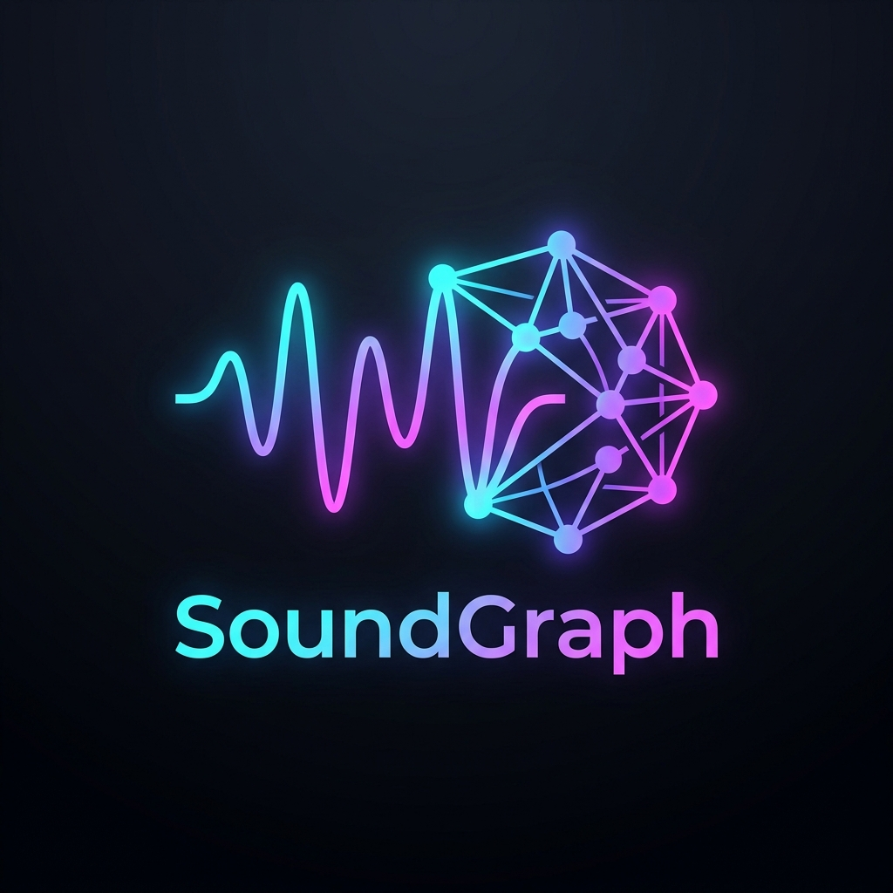

# 🎵 SoundGraph

<div align="center">
  

  ### Autonomous Multimodal Music Taste Knowledge Graph
  **Graph-RAG Discovery · Neo4j Graph Data Science (GDS) · Gemini 768-D Multimodal Vectors · LinUCB Contextual Bandits**

  [](https://opensource.org/licenses/MIT)
  [](https://neo4j.com/)
  [](https://fastapi.tiangolo.com/)
  [](https://ai.google.dev/)
  [](https://redis.io/)
  [](https://react.dev/)
  [](https://vitejs.dev/)
</div>

---

## 🌟 Executive Summary

**SoundGraph** is a commercial grade music intelligence and deck curation platform. It unifies heterogeneous listening history and telemetry from **Spotify** and **YouTube Music** into a property graph powered by **Neo4j Graph Data Science (GDS)** and **Google Gemini 768-D Multimodal Embeddings**.

Rather than relying on black-box collaborative filtering or static playlist buckets, SoundGraph constructs an explainable topological knowledge graph of your acoustic identity. It clusters your listening history into dynamic multi-centroid taste personas, balances exploration versus exploitation with contextual multi-armed bandits (LinUCB), enables instant acoustic humming and visual vibe recognition via Gemini, and delivers recommendations through an infinite 3D tactile card deck with real-time 30-second AAC audio previews and official high-resolution album covers.

---

## 🏗️ Master Architectural Blueprint

```
┌────────────────────────────────────────────────────────────────────────────────────────┐
│                                INGESTION & FEDERATION LAYER                            │
│  Spotify Web API (OAuth PKCE)                  Google YouTube Data API v3              │
│  • Top Tracks (short, med, long term)         • YouTube Music Liked Music (LM)         │
│  • Saved Library (with offset pagination)      • User Music Playlists & Channels       │
│  • Audio Features (energy, valence, tempo)     • 600x600 Official Album Art & Previews │
└───────────────────────────────────────────┬────────────────────────────────────────────┘
                                            │
                                            ▼
┌────────────────────────────────────────────────────────────────────────────────────────┐
│                         UNIFIED GRAPH ETL & DEDUPLICATION PIPELINE                     │
│  • Cross-platform entity reconciliation: spotify:track:* <-> youtube:video:*          │
│  • Multi-tenant schema normalization & metadata sanitization                           │
│  • Transactional Cypher batch UNWIND loader (t:Track, a:Artist, g:Genre, u:User)       │
└───────────────────────────────────────────┬────────────────────────────────────────────┘
                                            │
                     ┌──────────────────────┴──────────────────────┐
                     ▼                                             ▼
┌───────────────────────────────────────────┐ ┌──────────────────────────────────────────┐
│      GEMINI MULTIMODAL EMBEDDING CORE     │ │         NEO4J KNOWLEDGE GRAPH DB         │
│  • gemini-embedding-2 (768-D vectors)     │ │  • (:User)-[:LISTENED_TO]->(:Track)      │
│  • Semantic verbalization of acoustic DNA │ │  • (:Track)-[:BY]->(:Artist)             │
│  • Visual vibe board & album art vectors  │ │  • (:Track)-[:IN_GENRE]->(:Genre)        │
│  • Audio waveform snippet humming vectors │ │  • (:Track)-[:SIMILAR_TO]->(:Track)      │
│  • Redis UnifiedCache vector acceleration │ │  • Neo4j HNSW Vector Index (768-D)       │
└─────────────────────┬─────────────────────┘ └────────────────────┬─────────────────────┘
                      │                                            │
                      └──────────────────────┬─────────────────────┘
                                             │
                                             ▼
┌────────────────────────────────────────────────────────────────────────────────────────┐
│                        HYBRID GRAPH-RAG RECOMMENDATION ENGINE                          │
│                                                                                        │
│  1. Multi-Centroid Taste Personas (Spherical K-Means clustering on listening history)  │
│  2. HNSW Vector Querying (db.index.vector.queryNodes per persona centroid)             │
│  3. LinUCB Contextual Multi-Armed Bandit (RLHF online exploration / exploitation)      │
│  4. Graph Data Science (GDS) Algorithms:                                               │
│     • gds.nodeSimilarity: Topological Jaccard & Cosine track neighborhoods             │
│     • gds.pageRank: Graph centrality of core taste anchor artists                      │
│     • gds.louvain: Emergent musical community detection                                │
│     • gds.shortestPath: Dijkstra topological bridge discovery between artists          │
│  5. AIFlowChainer: Hamiltonian nearest-neighbor acoustic transition continuity         │
│  6. Autonomous FrontierFetcher: Live YouTube/Spotify expansion on sparse catalog nodes │
└───────────────────────────────────────────┬────────────────────────────────────────────┘
                                            │
                                            ▼
┌────────────────────────────────────────────────────────────────────────────────────────┐
│                            FASTAPI REST & WEBSOCKET GATEWAY                            │
│  • Port 8001: Async endpoints with Pydantic v2 schemas                                 │
│  • WebSocket /ws/live: Live frontier injection, GDS progression, telemetry feed        │
└───────────────────────────────────────────┬────────────────────────────────────────────┘
                                            │
                                            ▼
┌────────────────────────────────────────────────────────────────────────────────────────┐
│                              COMMERCIAL REACT 18 FRONTEND                              │
│  • 3D Levitating Infinite Card Deck (CardDeck3D): Draggable gestures, 30s AAC audio   │
│  • Taste & Library Ledger (LibraryDrawer): Real-time likes, passes, artists, playlists │
│  • Acoustic Lens Modal: Audio snippet/humming recorder + visual vibe board search      │
│  • Vibe AI Assistant (MoodChatModal): Natural language prompt & frontier expansion     │
│  • Global Bottom Player (AudioPlayerBar): Scrubbing, volume, external stream deep links│
└────────────────────────────────────────────────────────────────────────────────────────┘
```

---

## 📐 Neo4j Graph Schema & Relationship Topology

```
                  ┌───────────────┐
                  │    (:User)    │
                  └───┬───────┬───┘
                      │       │
       [:CREATED_DECK]│       │[:LISTENED_TO {play_count, last_played}]
                      ▼       ▼
               ┌─────────┐  ┌─────────┐
               │ (:Deck) │  │(:Track) │
               └────┬────┘  └──┬───┬──┘
                    │          │   │
        [:CONTAINS] │          │   │[:BY]
                    │          │   ▼
                    │          │ ┌──────────┐
                    │          │ │ (:Artist)│
                    │          │ └──┬───────┘
                    │          │    │
                    │   [:IN_GENRE] │[:IN_GENRE]
                    │          │    │
                    ▼          ▼    ▼
                    ┌──────────────┐
                    │   (:Genre)   │
                    └──────────────┘
```

### Node Specifications

| Node Label | Core Properties | Description |
| :--- | :--- | :--- |
| `(:User)` | `id`, `name`, `source`, `avatar_url`, `created_at` | User identity node (supports unified multi-platform identities). |
| `(:Track)` | `id`, `name`, `source`, `cover_url`, `preview_url`, `energy`, `valence`, `danceability`, `tempo`, `popularity`, `embedding` (768-D) | Canonical track representation with high-res cover art and audio preview streams. |
| `(:Artist)` | `id`, `name`, `source`, `pagerank`, `community` | Music artists with GDS PageRank centrality metrics. |
| `(:Genre)` | `name` | Normalized musical genre anchors (e.g. `synthwave`, `hip hop`, `indie rock`). |
| `(:Album)` | `id`, `name` | Album entity connected via `[:IN_ALBUM]`. |
| `(:Deck)` | `id`, `name`, `prompt`, `vibe`, `created_at`, `is_auto_replenish` | User-created and saved personalized card decks. |
| `(:MoodQuery)` | `prompt`, `timestamp` | Recorded natural-language query nodes representing expressed taste intent. |

### Edge Relationships

- `(u:User)-[:LISTENED_TO {play_count, last_played, source}]->(t:Track)`: Historical consumption telemetry.
- `(u:User)-[:FEEDBACK {reward, updated_at}]->(t:Track)`: Online RLHF feedback ledger (`+1.0` for like, `-1.0` for pass).
- `(t:Track)-[:BY]->(a:Artist)`: Authorship relationship.
- `(t:Track)-[:IN_GENRE]->(g:Genre)`: Primary and secondary genre associations.
- `(t:Track)-[:SIMILAR_TO {score}]->(t2:Track)`: High-order topological similarity calculated via GDS.
- `(u:User)-[:CREATED_DECK]->(d:Deck)`: Authorship of custom personalized decks.
- `(d:Deck)-[:CONTAINS {position, added_at}]->(t:Track)`: Ordered tracks encapsulated inside a deck.

### Vector Index Definition
```cypher
CREATE VECTOR INDEX track_embeddings IF NOT EXISTS
FOR (t:Track) ON (t.embedding)
OPTIONS {
  indexConfig: {
    `vector.dimensions`: 768,
    `vector.similarity_function`: 'cosine'
  }
}
```

---

## 🧠 Core Algorithmic Engines

### 1. Multi-Centroid Taste Persona Clustering (`PersonaClusterer`)
Rather than reducing a user to a single average vector, SoundGraph applies **Spherical K-Means** to the user's listened track embeddings. It extracts up to 3 distinct centroids representing separate musical personas (e.g., *Late-Night Pakistani Hip Hop*, *French House / Synthwave*, *Acoustic Bollywood*). Each persona centroid queries the Neo4j HNSW vector index independently.

### 2. Contextual Multi-Armed Bandit (`ContextualLinUCB`)
To solve the recommendation filter-bubble problem, an online **LinUCB** bandit algorithm balances:
- **Arm 0 (Exploit)**: Candidates from multi-centroid taste personas.
- **Arm 1 (Graph Proximity)**: Candidates connected via topological `SIMILAR_TO` edges.
- **Arm 2 (Catalog Diversity)**: Broad catalog backfill.
- **Arm 3 (Frontier Wildcard)**: Dynamic exploratory leaps into unvisited genres.

Feedback is updated in real time via **implicit dwell time** (continuous tracking of how long a user previews a card) and **explicit swipes** (`+1.0` for like, `-1.0` for pass).

### 3. Harmonic Flow Chaining (`AIFlowChainer`)
Before presenting cards to the user, SoundGraph solves a local Hamiltonian path problem across candidate vectors. Tracks are arranged so that consecutive cards transition harmonically in acoustic energy and valence, creating the feeling of a seamless DJ progression rather than an erratic shuffle.

### 4. Acoustic Lens & Multimodal Search (`AcousticLensService`)
Powered by Google Gemini 2.5 Flash:
- **Audio Snippet / Humming**: The user records a 5 to 10 second audio clip directly from the browser microphone. Gemini analyzes the pitch, acoustic signature, and lyrics, and SoundGraph resolves the track into Neo4j.
- **Visual Vibe Search**: Users upload a photo, fashion mood board, or aesthetic image. Gemini projects the visual mood into the 768-D latent space to surface sonically matching tracks.

---

## 🔌 API Blueprint

### Authentication & Sessions (`/auth`)
- `GET /auth/spotify/login`: Initiates Spotify OAuth authorization flow.
- `GET /auth/spotify/callback`: Exchanges authorization code, saves tokens with silent refresh, and initializes profile.
- `POST /auth/spotify/credentials`: Dynamically configures client credentials at runtime.
- `GET /auth/google/login`: Initiates Google / YouTube OAuth authorization flow.
- `GET /auth/google/callback`: Exchanges Google OAuth code and initializes profile.
- `POST /auth/google/credentials`: Configures Google client credentials at runtime.
- `GET /auth/me`: Returns current user session state, active platform connections, and token status.
- `POST /auth/logout`: Clears Redis session caches.

### Ingestion Pipeline (`/ingest`)
- `POST /ingest/spotify`: Asynchronously ingests user top tracks, saved songs, and playlists.
- `POST /ingest/youtube`: Ingests YouTube Music Liked Music (`LM`) and user playlists with full pagination.
- `POST /ingest/youtube/sync`: Synchronizes custom YouTube playlist URLs or search terms.
- `POST /ingest/demo`: Seeds canonical multi-genre demo dataset into Neo4j and executes GDS algorithms.

### Recommendations & Discovery (`/recommendations`)
- `GET /recommendations`: Fetches infinite stream of candidate cards. Supports `exclude_ids`, `mood` (`euphoric`, `melancholic`, `chill`, `high_energy`), and `limit`.
- `POST /recommendations/feedback`: Records user swipe actions (`reward: +1.0` or `-1.0`) to update graph weights.
- `POST /telemetry/dwell`: Records continuous playback dwell time to optimize bandit policies.
- `GET /user/taste-profile`: Returns user top artists, top playlists, likes/dislikes ledger, and acoustic averages.
- `GET /library`: Returns ingested library tracks with mood filters, search, and sorting strategies.
- `GET /recommendations/explain/{track_id}`: Returns human-readable explanation of why a track was recommended.

### Multimodal Vibe & AI Assistant (`/vibe`, `/chat`)
- `POST /chat`: Natural language mood and artist search assistant with dynamic frontier catalog expansion.
- `POST /vibe/image`: Visual vibe search projecting images into matching musical tracks.
- `POST /vibe/identify-audio`: Multimodal audio humming and snippet identification.
- `GET /vibe/suggestions`: Dynamic prompt suggestions personalized to user listening history.

### Graph Data Science & Analytics (`/graph`, `/artists`)
- `GET /graph/stats`: Returns node counts, edge counts, and graph density statistics.
- `GET /graph/visualize`: Returns WebGL node-link data for 2D/3D force-directed graph visualization.
- `GET /artists/top`: Returns PageRank centrality rankings of catalog artists.
- `GET /shortest-path`: Finds the Dijkstra shortest path between any two artists in the taste graph.

### Real-Time Streaming
- `WS /ws/live`: Full-duplex WebSocket connection delivering real-time ingestion progress, live frontier candidates, and GDS algorithm execution events.

---

## 🎨 UI/UX Design System Standards

The frontend is built with pure Vanilla CSS tokens and modern React components adhering to commercial SaaS principles:

- **Color Palette**: Pitch black dark mode with curated surface levels (`#000000` base, `#181818` card surfaces, `#1F1F1F` elements, `#272727` borders, `#a855f7` purple brand accent).
- **Typography**: `Manrope` for clean display hierarchy paired with `Geist Mono` for tabular metrics and durations.
- **Nested Radii**: Strictly nested border radii (`inner = outer - gap`).
- **No Stock Fallbacks**: Cards display real high-resolution album covers fetched from official music streaming CDNs with graceful dark record sleeve fallbacks.
- **Commercial Copy**: Zero developer jargon or internal model terminology visible to the end user.
- **Tactile 3D Gestures**: Smooth CSS 3D matrix perspective on the card deck with pointer and drag physics for swiping.

---

## 🚀 Local Installation & Setup

### 1. Prerequisites
- **Neo4j Database**: Version 2026.09+ with **APOC** and **Graph Data Science (GDS)** plugins enabled.
- **Redis**: Local or cloud instance for `UnifiedCache`.
- **Python**: 3.10+ (tested on Python 3.12 / 3.14).
- **Node.js**: 18+ with `npm`.

### 2. Environment Configuration
Create a `.env` file in the project root:
```env
# Neo4j Graph Database
NEO4J_URI=bolt://localhost:7687
NEO4J_USER=neo4j
NEO4J_PASSWORD=your_password
NEO4J_DATABASE=neo4j

# Spotify Developer Application (Optional for custom user auth)
SPOTIFY_CLIENT_ID=your_spotify_client_id
SPOTIFY_CLIENT_SECRET=your_spotify_client_secret
SPOTIFY_REDIRECT_URI=http://127.0.0.1:8001/auth/spotify/callback

# Google / YouTube OAuth (Optional for custom user auth)
GOOGLE_CLIENT_ID=your_google_client_id
GOOGLE_CLIENT_SECRET=your_google_client_secret
GOOGLE_REDIRECT_URI=http://127.0.0.1:8001/auth/google/callback

# AI & Cache
GEMINI_API_KEY=your_gemini_api_key
REDIS_URL=redis://localhost:6379/0

# Application Ports
FRONTEND_URL=http://localhost:5173
API_PORT=8001
API_HOST=0.0.0.0
```

### 3. Backend Setup
```bash
# Create and activate virtual environment
python3 -m venv venv
source venv/bin/activate

# Install dependencies
pip install -r backend/requirements.txt

# Start FastAPI server on port 8001
PYTHONPATH=. uvicorn backend.main:app --host 0.0.0.0 --port 8001 --reload
```
Interactive OpenAPI documentation will be accessible at: `http://localhost:8001/docs`

### 4. Frontend Setup
```bash
cd frontend
npm install
npm run dev -- --host 0.0.0.0 --port 5173
```
The application interface will be live at: `http://localhost:5173`

---

## 🧪 Testing & Validation

```bash
# Verify Neo4j connectivity and vector index status
venv/bin/python -c '
from backend.core.neo4j_driver import neo4j_conn
res = neo4j_conn.query("SHOW INDEXES")
print(f"Verified {len(res)} database indices.")
'

# Test recommendation generation
curl -s "http://localhost:8001/recommendations?limit=3" | python3 -m json.tool

# Run frontend build check
cd frontend && npm run build
```

---

## 📄 License
This project is open-source software licensed under the [MIT License](LICENSE).
