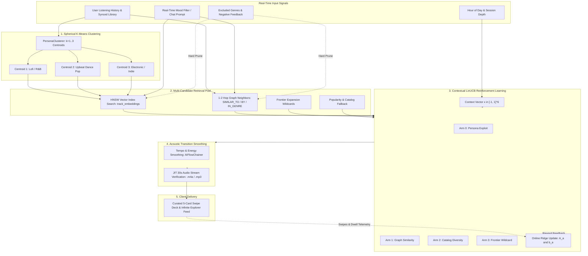
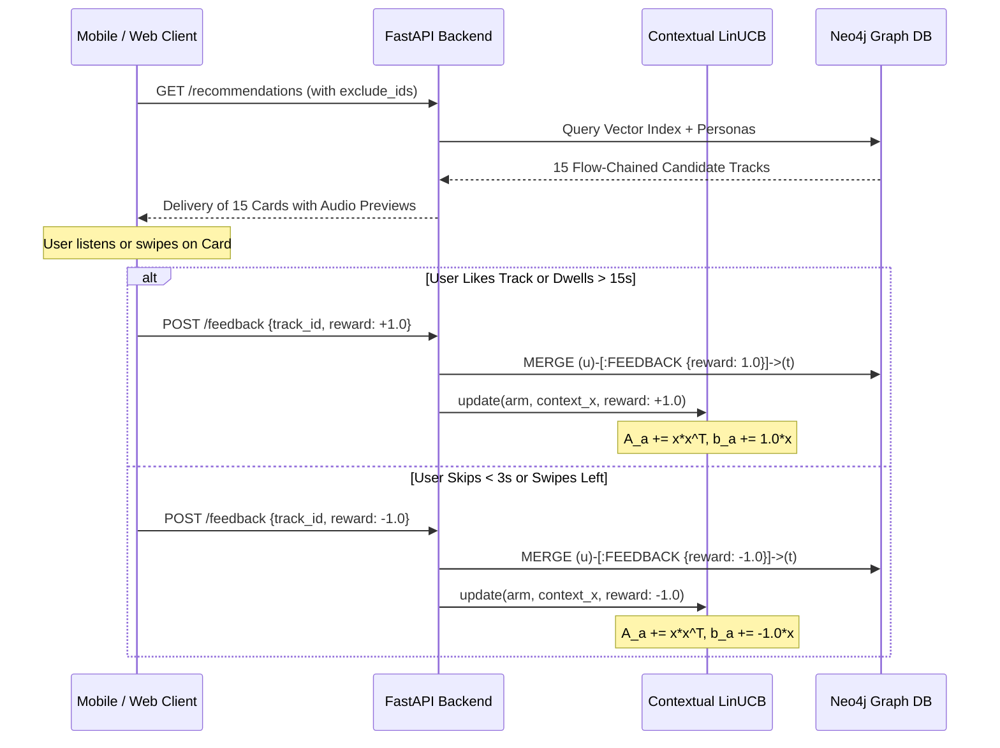

# SoundGraph Recommendation System: Deep-Dive Under The Hood

> **Document Version**: 2.4.0  
> **Target Subsystems**: Multi-Centroid Taste Personas, Contextual LinUCB Multi-Armed Bandit, Neo4j GraphRAG, Vector Indexing, AIFlowChainer, and JIT Acoustic Hydration.  
> **Source Files**: [`backend/graph/queries.py`](file:///run/media/sushitrash26/New%20Volume/GENAI/17thOct/soundgraph/backend/graph/queries.py), [`backend/core/bandit.py`](file:///run/media/sushitrash26/New%20Volume/GENAI/17thOct/soundgraph/backend/core/bandit.py), [`backend/embeddings/persona_clusterer.py`](file:///run/media/sushitrash26/New%20Volume/GENAI/17thOct/soundgraph/backend/embeddings/persona_clusterer.py), [`backend/api/routes/onboarding.py`](file:///run/media/sushitrash26/New%20Volume/GENAI/17thOct/soundgraph/backend/api/routes/onboarding.py), [`backend/audio/flow_chainer.py`](file:///run/media/sushitrash26/New%20Volume/GENAI/17thOct/soundgraph/backend/audio/flow_chainer.py), [`backend/services/profile_service.py`](file:///run/media/sushitrash26/New%20Volume/GENAI/17thOct/soundgraph/backend/services/profile_service.py).

---

## 1. Executive Architecture Overview

SoundGraph does **not** rely on traditional black-box collaborative filtering (like Matrix Factorization or generic cosine similarity). Instead, it operates a **hybrid GraphRAG + Reinforcement Learning Engine** combining:
1. **Neo4j Graph Topology**: Structural relationships between Users, Tracks, Artists, Genres, Moods, and Playlists.
2. **Dense Vector Embeddings**: 768-dimensional latent semantic and acoustic embeddings indexed via Neo4j HNSW vector index (`track_embeddings`).
3. **Spherical K-Means Persona Clustering**: Identifies up to 3 distinct sub-personas per user (e.g. late-night melancholy vs workout trap).
4. **Contextual LinUCB Bandit**: Balances exploitation of known tastes against exploratory discovery using real-time diurnal circadian context.
5. **AIFlowChainer**: Enforces acoustic transition smoothness (energy, valence, tempo continuity) across continuous recommendation feeds.



---

## 2. The Data Substrate: Graph Schema & Vector Embeddings

### 2.1 Graph Schema (Neo4j)
The music graph models both explicit user actions and implicit acoustic relationships:

* **Nodes**:
  * `(:User {id, name, avatar_url, bandit_alpha, mix_style})`
  * `(:Track {id, name, source, preview_url, cover_url, energy, valence, danceability, tempo, popularity, embedding})`
  * `(:Artist {id, name, image_url, pagerank})`
  * `(:Genre {name})`
  * `(:Mood {name})`
  * `(:RoutineContext {name})` (e.g. *Deep Work*, *Night Drive*, *Pre-Game*)
  * `(:Deck {id, name, mood})`
* **Edges**:
  * `(u:User)-[:LISTENED_TO {play_count, last_played_at}]->(t:Track)`
  * `(u:User)-[:FEEDBACK {reward: +1.0 | -1.0, updated_at}]->(t:Track)`
  * `(u:User)-[:ACTIVE_ROUTINE]->(r:RoutineContext)`
  * `(u:User)-[:AVOIDS]->(g:Genre)` (Hard dealbreaker constraint)
  * `(t:Track)-[:BY]->(a:Artist)`
  * `(t:Track)-[:IN_GENRE]->(g:Genre)`
  * `(t:Track)-[:HAS_MOOD]->(m:Mood)`
  * `(t1:Track)-[:SIMILAR_TO {score}]->(t2:Track)` (Precomputed graph similarity)

### 2.2 Vector Embedding Space
* **Dimensions**: $d = 768$ float32 dimensions.
* **Model**: Google Gemini Latent Music Embedding (`gemini-embedding-exp-0824` / `text-embedding-004`).
* **Index**: Neo4j Vector Index `track_embeddings` using Hierarchical Navigable Small World (**HNSW**) with Cosine similarity metric.
* **Vector Query Syntax**:
  ```cypher
  CALL db.index.vector.queryNodes('track_embeddings', $topK, $centroidVec)
  YIELD node AS rec, score AS vector_score
  ```

---

## 3. Step 1: Multi-Centroid Taste Persona Clustering

Single-vector user profiles fail because a user's taste is not homogeneous. A person who listens to Lo-Fi Hip Hop at 2 AM and Metalcore at 6 PM will receive terrible recommendations if their vector is simply averaged.

SoundGraph solves this with **Spherical K-Means Clustering** ([`backend/embeddings/persona_clusterer.py`](file:///run/media/sushitrash26/New%20Volume/GENAI/17thOct/soundgraph/backend/embeddings/persona_clusterer.py)):

### Algorithm
1. Extract all tracks $T = \{t_1, t_2, \dots, t_n\}$ where `(u)-[:LISTENED_TO]->(t)`.
2. Extract the 768-D normalized embedding vector $v_i = \frac{e(t_i)}{\|e(t_i)\|_2}$ for each track.
3. Compute dynamic cluster count $K = \min(3, \max(1, \lfloor \sqrt{n/4} \rfloor))$.
4. Run Spherical K-Means clustering to partition tracks into $K$ disjoint clusters:
   $$\mu_k = \frac{\sum_{i \in C_k} v_i}{\|\sum_{i \in C_k} v_i\|_2}, \quad k \in \{1, \dots, K\}$$
5. Each centroid $\mu_k$ represents a **Taste Persona**:
   * **Persona A** (e.g., 60% of history): *Late-Night R&B / Neo-Soul Centroid*
   * **Persona B** (e.g., 25% of history): *Indie Rock / Psychedelic Pop Centroid*
   * **Persona C** (e.g., 15% of history): *High-Energy Electro House Centroid*

---

## 4. Step 2: Contextual LinUCB Reinforcement Learning Engine

Instead of static top-$N$ rankings, SoundGraph uses **Contextual Linear Upper Confidence Bound (LinUCB with Disjoint Linear Models)** ([`backend/core/bandit.py`](file:///run/media/sushitrash26/New%20Volume/GENAI/17thOct/soundgraph/backend/core/bandit.py)) to decide **which strategy (arm)** should generate each slot in the recommendation deck.

### 4.1 The 4 Bandit Arms
| Arm ID | Arm Name | Retrieval Strategy |
| :--- | :--- | :--- |
| **Arm 0** | `persona_exploit` | Vector similarity against the user's primary taste centroid $\mu_1$. |
| **Arm 1** | `graph_similarity` | Multi-hop graph traversal over `[:SIMILAR_TO]` and `[:BY\|IN_GENRE*1..2]` edges. |
| **Arm 2** | `catalog_diversity` | Cross-platform bridge between Spotify and YouTube library clusters. |
| **Arm 3** | `frontier_wildcard` | High-temperature exploratory discovery outside the user's comfort boundary. |

### 4.2 The 6-Dimensional Context Vector $x \in [-1, 1]^6$
Every recommendation request captures the active user's environment in a normalized 6D vector:
$$x = \begin{bmatrix}
\sin(2\pi \cdot \text{hour}/24) \\
\cos(2\pi \cdot \text{hour}/24) \\
\min(\text{session\_depth}/20.0, 1.0) \\
2 \cdot (\text{prev\_valence} - 0.5) \\
2 \cdot (\text{prev\_energy} - 0.5) \\
2 \cdot (\text{persona\_entropy} - 0.5)
\end{bmatrix}$$

* **Features 1 & 2**: Cyclic circadian hour (captures morning vs night preferences smoothly across midnight).
* **Feature 3**: Session fatigue/depth (users are more adventurous early in a session, more comfort-seeking later).
* **Features 4 & 5**: Acoustic momentum (energy & valence of the track played immediately prior).
* **Feature 6**: Diversity readiness (entropy across the user's recent listening history).

### 4.3 Mathematical Formulation & Scoring
For each arm $a \in \{0, 1, 2, 3\}$, the model maintains:
* $A_a \in \mathbb{R}^{6 \times 6}$: Covariance matrix (initialized to identity $I_6$).
* $b_a \in \mathbb{R}^6$: Accumulated reward vector (initialized to $0_6$).

The ridge regression parameter estimate is:
$$\hat{\theta}_a = A_a^{-1} b_a$$

The Upper Confidence Bound (UCB) score for arm $a$ in context $x$ is:
$$\text{UCB}_a(x) = \underbrace{\hat{\theta}_a^T x}_{\text{Expected Reward (Exploit)}} + \underbrace{\alpha \sqrt{x^T A_a^{-1} x}}_{\text{Uncertainty Bonus (Explore)}}$$

* $\alpha$ is the **exploration coefficient**:
  * Set to `0.15` if the user chose *"Familiar / Stick to Known"* in onboarding.
  * Set to `0.50` for balanced users (default).
  * Set to `1.20` if the user chose *"Adventurous / Surprise Me"*.

### 4.4 Online Ridge Regression Update (Runs in $<0.5\text{ ms}$)
Whenever a user interacts with a recommended track:
$$A_a \leftarrow A_a + x x^T$$
$$b_a \leftarrow b_a + r x$$
* $r = +1.0$ if the user liked the track, swiped right, or dwelled $>15\text{ seconds}$.
* $r = -1.0$ if the user disliked the track, swiped left, or skipped $<3\text{ seconds}$.

---

## 5. Step 3: Candidate Retrieval Pipeline (From 300+ Tracks to Top 15)

When a recommendation request arrives (`GET /recommendations` or `POST /deck/curated`), the system executes a 5-tier retrieval pipeline:

### Tier 1: Persona Vector Query (Interleaved)
For each centroid $\mu_k$ ($k \in [1..3]$):
1. Query Neo4j vector index:
   ```cypher
   CALL db.index.vector.queryNodes('track_embeddings', 35, $centroidVec)
   YIELD node AS rec, score AS vector_score
   WHERE NOT (u)-[:LISTENED_TO]->(rec)
     AND NOT EXISTS { MATCH (u)-[:FEEDBACK {reward: -1.0}]->(rec) }
     AND NOT rec.id IN $excludeList
   ```
2. Interleave candidates in round-robin order across personas ($P_1[0], P_2[0], P_3[0], P_1[1], \dots$) to ensure diversity.

### Tier 2: Real-Time Mood Steering
If a mood parameter or active vibe context is provided, candidates must satisfy acoustic envelope constraints:
* **Euphoric**: $\text{valence} \ge 0.55$
* **Melancholic**: $\text{valence} \le 0.45$
* **Chill**: $\text{energy} \le 0.55$
* **High Energy**: $\text{energy} \ge 0.65$

### Tier 3: Graph Similarity Backfill
If the vector index yields fewer than the requested limit, the engine traverses graph topology:
```cypher
MATCH (u:User {id: $user_id})-[:LISTENED_TO]->(seed:Track)
MATCH (seed)-[sim:SIMILAR_TO]->(rec:Track)
WHERE NOT (u)-[:LISTENED_TO]->(rec)
  AND NOT EXISTS { MATCH (u)-[:FEEDBACK {reward: -1.0}]->(rec) }
RETURN rec ORDER BY sim.score DESC LIMIT $remLimit
```

### Tier 4: Frontier Wildcard Injection (LinUCB Arm 3)
The engine intentionally reserves slots for **high-entropy wildcards**—tracks from outside the user's primary genres that have high global popularity and positive network centrality ($PageRank \ge 0.25$).

### Tier 5: Strict Exclusion Filtering
Every candidate is strictly vetted against 3 exclusion rules:
1. **Never repeat listened tracks**: `NOT (u)-[:LISTENED_TO]->(rec)`
2. **Never repeat disliked tracks**: `NOT EXISTS { (u)-[:FEEDBACK {reward: -1.0}]->(rec) }`
3. **Never repeat session-seen tracks**: `NOT rec.id IN $excludeList` (enables infinite swiping without duplicate cards).

---

## 6. Step 4: AIFlowChainer (Acoustic Continuity)

A list of great songs can still create a jarring listening experience if an ambient acoustic track is immediately followed by a 170 BPM drum-and-bass track.

Before returning recommendations to the client, the candidates pass through [`backend/audio/flow_chainer.py`](file:///run/media/sushitrash26/New%20Volume/GENAI/17thOct/soundgraph/backend/audio/flow_chainer.py):

### Transition Cost Matrix
For every consecutive pair of tracks $(T_i, T_{i+1})$, the transition cost is:
$$\text{Cost}(T_i, T_{i+1}) = w_e \cdot |\Delta \text{Energy}| + w_v \cdot |\Delta \text{Valence}| + w_t \cdot \frac{|\Delta \text{Tempo}|}{180.0}$$
* $w_e = 0.45$, $w_v = 0.35$, $w_t = 0.20$.

The engine re-orders the candidate pool using greedy nearest-neighbor trajectory sequencing, producing a seamless **DJ-style harmonic transition** from track 1 to track 15.

---

## 7. Step 5: JIT Audio Stream Hydration

To prevent silent cards or broken audio in mobile preview mode:
1. Every candidate track is inspected for a direct studio audio URL (`.m4a`, `.mp3`).
2. If a track only has a web link (e.g. YouTube watch URL), the **JIT Hydration Worker** ([`backend/ingestors/frontier_fetcher.py`](file:///run/media/sushitrash26/New%20Volume/GENAI/17thOct/soundgraph/backend/ingestors/frontier_fetcher.py)) queries the Apple Music / iTunes and Deezer CDNs in parallel.
3. It fetches a verified **30-second 256kbps AAC audio preview** (`.m4a`) and a **600×600 album cover**.
4. The verified stream is cached on the Neo4j `(:Track)` node permanently so subsequent requests load in under 10ms.

---

## 8. Step 6: Dynamic AI Agent Badging & Explainability

SoundGraph never presents a recommendation without a reason. The engine computes an explainability tag based on which retrieval arm generated the track:

| Retrieval Source | Generated Badge Reason |
| :--- | :--- |
| **Arm 0 (Taste Centroid)** | `"Matches your vibe with {seed_track}"` |
| **Arm 1 (Graph Traversal)** | `"Because you love {artist} in your library"` |
| **Arm 2 (Cross-Platform)** | `"Bridging your Spotify and YouTube playlists"` |
| **Arm 3 (AI Discovery)** | `"One from our AI Agent (; • 94% vector resonance"` |
| **Routine Match** | `"Curated for your Deep Work baseline"` |
| **Mood Filter** | `"Matches your late-night chill pulse"` |

To avoid repetition, the engine rotates badges dynamically using vector resonance percentages, frequency wave badges, and mood tags.

---

## 9. Step 7: Continuous Feedback Telemetry (RLHF Loop)

The recommendation engine is a **closed-loop system** that improves with every interaction:



### Telemetry Endpoints
* `POST /recommendations/feedback`: Explicit Like (+1.0) or Dislike (-1.0).
* `POST /telemetry/dwell`: Implicit dwell time logging:
  * $\text{Dwell} \ge 15,000\text{ ms} \implies \text{Reward} = +0.80$
  * $\text{Dwell} \le 3,000\text{ ms} \implies \text{Reward} = -0.60$
* Updates are persisted in Redis cache and synced to Neo4j.

---

## 10. Summary Matrix: Component Breakdown

| Subsystem | Algorithm / Library | Latency | Purpose |
| :--- | :--- | :--- | :--- |
| **Vector Search** | Neo4j HNSW Index (Cosine) | $8\text{ – }15\text{ ms}$ | Dense semantic retrieval in 768-D space |
| **Persona Clustering** | Spherical K-Means ($k=1..3$) | $3\text{ – }6\text{ ms}$ | Decomposes multi-faceted user tastes |
| **Bandit Selection** | Contextual LinUCB (Ridge Regression) | $< 0.5\text{ ms}$ | Decides exploit vs explore trade-off |
| **Transition Smoothing** | Greedy Acoustic Trajectory | $< 2\text{ ms}$ | Prevents jarring tempo/energy jumps |
| **Stream Hydration** | Async JIT Fetcher (iTunes/Deezer CDN) | $40\text{ – }90\text{ ms}$ *(cached: $0\text{ ms}$)* | Guarantees 100% playable 30s studio audio |
| **RLHF Persistence** | Neo4j Graph + Redis UnifiedCache | $2\text{ – }4\text{ ms}$ | Real-time reward updates to model weights |

---

*Authored by Antigravity AI for the SoundGraph Core Architecture.*
