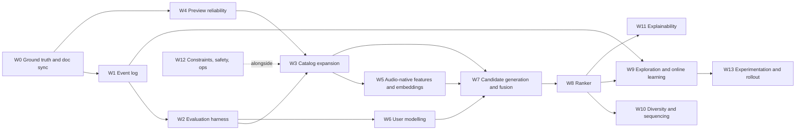

# SoundGraph → 10/10 Recommendation System
## Agent Playbook (question-driven, measure-first)

> **Audience:** the coding agent working on SoundGraph.
> **Owner:** the project owner, who will answer your questions.
> **Written:** 2026-10-20, from a design-doc review plus an owner-supplied code audit.
> **Status of this file:** a *plan*, not a spec. Nothing here is approved until the owner confirms it in the Decision Log (§10).
> **Realism note:** with ~6 users and 332 tracks, "10/10" means *complete, measurable, best-practice and honest*, not Spotify scale. Every workstream below is sized for a small beta that is heading to ~500–1,000 users and ~15–30k tracks.

---

## 0. READ FIRST — how you must behave

**Your first action is NOT to write code.** Do this, in order:

1. Read the repo and fill in the *Verification Checklist* (§1.3). Mark each line CONFIRMED / WRONG / UNKNOWN.
2. Ask the owner the **Phase-0 questions** (§5), at most 5 per message, each with your recommended default so the owner can reply "default".
3. Write the answers to `DECISIONS.md` (template in §10).
4. Only then start Workstream W0, and only one workstream at a time.

### Operating rules

| # | Rule |
|---|------|
| R1 | **Ask before acting.** Each workstream has an "Ask the owner" block. Ask it before implementing. Offer a default and say what the default costs or risks. |
| R2 | **No silent changes** to: Neo4j schema, vector indexes, existing endpoint response shapes, reward semantics, stored user data, or deletion of anything. Propose → wait for "approved" → implement. |
| R3 | **Measure before you change.** Capture a baseline metric snapshot before each workstream and report the delta afterwards. If you cannot measure it, say so and propose how. |
| R4 | **Small, flagged, reversible.** One workstream at a time. Behaviour changes sit behind a feature flag. Every migration has a rollback. Back up Neo4j before any schema or bulk-data change. |
| R5 | **Doc must equal code.** Whenever behaviour changes, update `docs/RECSYS.md` in the same change. Tag every claim `[IMPLEMENTED]`, `[PARTIAL]` or `[PLANNED]`. Never describe unimplemented behaviour as live. |
| R6 | **Never fabricate numbers.** If a number was not measured, write `UNMEASURED` and provide the query or script that would measure it. Estimates must be labelled `ESTIMATE`. |
| R7 | **Prefer boring + measurable over clever.** If a technique cannot be evaluated at current data volume, say so and propose a cheaper alternative. |
| R8 | **Respect constraints** in §1.2 (AuraDB Free limits, Gemini quota, no audio storage, P95 < 250 ms). If a plan would breach one, stop and ask. |
| R9 | **Report after each workstream** using the Change Report template (§10). |
| R10 | **If this document conflicts with the code you find, stop and ask.** The code is the source of truth; this document may be stale. |
| R11 | **Evidence rule.** Every factual claim about the code or data cites `file:line` or shows the raw query output. If two numbers disagree (e.g. total edges vs degree stats), reconcile them before proceeding. |

### How to ask good questions
- State the decision, why it matters, the options, and your recommended default.
- Group related questions; max 5 per message.
- If an answer is ambiguous, restate your interpretation and ask for a yes/no.
- Record every answer in `DECISIONS.md` with date and workstream ID.

---

## 1. Project snapshot (as audited — verify each line)

### 1.1 Facts

Legend: **[A]** owner-audited from code/DB · **[E]** estimate, unverified · **[D]** from the design doc, may not match code.

| Area | Value |
|------|-------|
| Stack | FastAPI backend, Neo4j AuraDB Free, Redis (`UnifiedCache`), Expo/React Native client **[A]** |
| Scale today | 6 users, 332 tracks, 266 artists, 377 `LISTENED_TO` edges, 71 `FEEDBACK` edges, 58 flat `Genre` nodes, 0 `Mood` nodes **[A]** |
| Per-user listened tracks (n) | 179, 168, 28, 2, plus two small accounts **[A]** |
| Heaviest user coverage | 179 of 332 tracks already heard (~54% of catalog) **[A, derived]** |
| Graph | 43,432 `SIMILAR_TO` edges reported, but W0 degree stats imply only ~8.3k (mean out-degree 25.1 × 332) and max in-degree 344 exceeds the 331 possible distinct sources, so parallel/duplicate edges are likely (**to reconcile**). 85 tracks (25.6%) have zero edges; 22 (6.6%) have > 300 **[A, W0]** |
| Embeddings | `gemini-embedding-2`, 768-d, cosine HNSW index `track_embeddings`. Input is a synthetic text string: name, artists, album, genres, and an "acoustic profile" containing energy/valence/danceability/acousticness numbers. Audio is **not** embedded **[A]** |
| Audio features | Real Spotify values on only 28 tracks (8.4%). Energy/valence/danceability for the rest are inferred from cosine similarity to bipolar text anchors. Tempo is null for 91.6% and defaults to 120 **[A]** |
| Previews | **Now iTunes** (`audio-ssl.itunes.apple.com`), free 30 s AAC. Spotify previews are no longer relied upon. Only ephemeral CDN URLs are stored, never audio files **[A + owner]** |
| UX | Swipe deck, batches of 15 cards, 30 s previews, deep links out to Spotify/YouTube Music. No continuous radio **[A]** |
| Serving | Deterministic 5-tier waterfall, arms statically tagged by tier. Bandit is **not** consulted at serve time **[A]** |
| Personas | `sklearn KMeans`, `K = min(3, max(1, floor(sqrt(n/4))))`, unweighted, refit on every request, μ₁ = largest cluster **[A]** |
| Candidate scoring | Tier 1 score `(1+cos)/2`; all tiers pooled and sorted by `(score, popularity)`; top 15 go to the flow chainer **[A]** |
| Flow chainer | Greedy nearest-neighbour path starting from the highest-score candidate; cost `0.45|ΔE| + 0.35|ΔV| + 0.20|ΔBPM|/180` **[A]** |
| Bandit | Per-user LinUCB in Redis (`bandit:{user}:arm_{i}`), 6-d context `[hour/24 (UTC), depth/10, 0.5, 0.5, dow/7, 0.0]`, no discounting, non-atomic read-modify-write, updated only from `POST /telemetry/dwell` using the context recomputed at feedback time **[A]** |
| Rewards | Explicit swipe ±1.0. Dwell: ≥15 s +0.8, 5–15 s +0.2, <3 s −0.6. Both endpoints are live **[A]** |
| Serve-time logging | **None** (no candidates, arms, contexts or positions are persisted) **[A]** |
| Evaluation | Manual testing and `/metrics` only. No offline replay, no A/B **[A]** |
| Matching (YouTube → iTunes) | Regex clean → exact internal match → iTunes search `limit=1`. No ISRC, no duration check **[A]** |
| Goal metric | Discovery **[A]** |
| Constraints | P95 < 250 ms on `GET /recommendations`; Gemini free tier 15 RPM; AuraDB Free 200k nodes / 400k relationships; no audio-file storage **[A]** |

### 1.2 Hard constraints (do not breach without asking)
1. AuraDB Free: 200,000 nodes, 400,000 relationships.
2. Gemini free tier: 15 requests/minute (check the current limit and the batch endpoint before designing ingestion).
3. Do not store audio files. Store URLs and derived numbers only (confirm the exact posture with the owner in W5).
4. `GET /recommendations` P95 < 250 ms.
5. Spotify Web API: audio-features, recommendations and related-artists are restricted for apps created after 2024-11-27 (verify the owner's app creation date). Treat Spotify audio features as unavailable for any new track.

### 1.3 Verification Checklist (fill before anything else)

Mark CONFIRMED / WRONG / UNKNOWN and attach the evidence (file:line or query output).

- [ ] V1. `get_recommendations` pools all tiers and sorts by `(score, popularity)` before `candidates[:15]`.
- [ ] V2. Whether "reserved" frontier-wildcard slots survive that global sort.
- [ ] V3. `PersonaClusterer.fit` is invoked on every request (no caching) and vectors are/aren't L2-normalised first.
- [ ] V4. Both `record_feedback` and `record_dwell_telemetry` update the bandit. Does one swipe produce two updates?
- [ ] V5. `user_id` on `GET /recommendations` comes from the auth token, not only a query parameter.
- [ ] V6. What `first_played` contains for synced libraries: real play time or the sync time?
- [ ] V7. Which code produces the 43,432 `SIMILAR_TO` edges (GDS or the cosine fallback), and with what `topK`.
- [ ] V8. Whether the JIT hydration worker described in the old doc exists and runs at serve time.
- [ ] V9. How energy/valence are computed for non-Spotify tracks, and whether those numbers are written back into the embedding text (circularity).
- [ ] V10. Timezone used for the `hour` context feature (UTC vs user-local).
- [ ] V11. Whether swipes on cards with no playable audio still write `FEEDBACK` and bandit updates.
- [ ] V12. How the client plays `preview_url` values hosted on youtube.com (webview/YouTube player vs `expo-audio`) and whether those cards are audible and dwell-tracked.
- [ ] V13. Which persona function is live (`PersonaClusterer.fit` vs `compute_taste_centroids`), whether play-count weights enter the clustering, and the actual K rule (observed: `min(3, floor(n/2))`).
- [ ] V14. Whether `SIMILAR_TO` has parallel duplicate edges (query in Appendix B) and which job wrote them (`CREATE` vs `MERGE`).
- [ ] V15. Whether the three "Astitva" accounts overlap in listened tracks (same person, different imports).

---

## 2. Findings (what is limiting the system)

Severity: **C** critical · **H** high · **M** medium · **L** low.

| ID | Sev | Finding | Evidence | Fixed in |
|----|-----|---------|----------|----------|
| F-01 | C | Catalog is too small; the heaviest user has heard 54% of it. Discovery cannot be achieved or evaluated. | 332 tracks; n=179 | W3 |
| F-02 | C | No serve-time logging. Bandit updates use feedback-time context and a client-reported arm; nothing can be replayed or evaluated off-policy. | Audit Q4, Q20 | W1 |
| F-03 | C | No evaluation harness, no baselines, no metrics definition beyond eyeballing. | Audit Q29 | W2 |
| F-04 | H | Bandit is not in the serve path. Arm rewards are confounded (arms 1 and 2 fire only when tiers 1–2 underfill). Per-user models have ~71 labels in total to learn from. | Audit Q6, Q22 | W9 |
| F-05 | H | `SIMILAR_TO` is a hub-and-isolate co-occurrence graph built from roughly one real person's history (25.6% of tracks isolated, 6.6% hubs, probable parallel duplicate edges). It cannot generalise and distorts graph backfill. *(An earlier "saturated ~40% density" reading was withdrawn after the W0 degree stats.)* | Audit Q1, Q9; W0 D-03 | W7 |
| F-06 | H | Most "acoustic" features are text-proxy values, likely compressed into a narrow band; 91.6% of tracks have no tempo. Mood filters and flow chainer treat them as real measurements. | Audit Q7, Q28 | W5 |
| F-07 | H | Scores from different tiers (cosine-mapped, graph score, popularity) are on different scales but sorted together. No artist cap. Round-robin persona interleave from the old doc does not exist. | Audit Q25, Q26 | W7, W10 |
| F-08 | H | Tracks without a playable preview are served. W0 found 43 null `preview_url` (13.0%) **plus** 133 tracks (40.1% of the catalog) whose `preview_url` is a youtube.com page that passed the reachability probe but is almost certainly not an audio stream. Effective playable coverage is at most 156/332 (47%) unless the client has another player for YouTube. Swipes on silent cards produce false dislikes and bandit penalties. | Audit Q31; W0 D-04 | W4 |
| F-09 | H | Design doc and code disagree on context features, interleaving, arm definitions, wildcard logic, mood tier. | Audit Q4–Q6, Q20, Q23 | W0 |
| F-10 | M | KMeans is unweighted and (probably) not on normalised vectors; K rule is fixed; centroid mean may land in an empty region of the space. | Audit Q13, Q14 | W6 |
| F-11 | M | Personas are never conditioned on context; μ₁ chosen by size only; all personas queried equally. | Audit Q17, Q18 | W6 |
| F-12 | M | Listened tracks are always excluded, so "Familiar / Stick to Known" users can never be served familiar music. | Audit Q15 | W6 |
| F-13 | M | Frontier wildcard = neighbours of the "furthest centroid"; popularity fallback adds popularity bias. | Audit Q6 | W10 |
| F-14 | M | Context features: UTC hour (linear, with midnight discontinuity), two constant features, a zero feature, no explicit intercept, no discounting. | Audit Q20, Q23 | W9 |
| F-15 | M | Flow chainer is mostly a 2-D smoother over proxy values, anchored on the top-score track; low value for an independent-card swipe deck. | Audit Q27, Q28 | W10 |
| F-16 | M | Reward design: possible double update (dwell + swipe), silent-card contamination, permanent blocks with no decay. | Audit Q21, Q24 | W9 |
| F-17 | M | Track matching uses first search hit only; no ISRC or duration check; estimated 5–12% wrong-version matches. | Audit Q12 (estimate) | W4 |
| F-18 | M | Genres are flat strings, so `AVOIDS metal` will not exclude `metalcore`. | Audit Q10 | W12 |
| F-19 | L | Explanations are decorative (rotated for variety), and "% vector resonance" is not a meaningful quantity. | Old doc §8 | W11 |
| F-20 | M | Redis bandit read-modify-write is not atomic. | Audit Q19 | W9, W12 |
| F-21 | M | Embedding text contains numeric feature strings and (possibly) values derived from the embedding itself: weak signal and possible circularity. | Audit Q8 | W5 |
| F-22 | L | `SIMILAR_TO` refresh is manual. | Audit Q9 | W7 |
| F-23 | L | Time-of-day uses server UTC; users in other timezones get shifted context. | Audit Q20 | W9 |
| F-24 | M | Persona clustering is refit on every request, which wastes latency budget. | Audit call path | W6, W12 |
| F-25 | M | `user_id` is a query parameter; verify it is bound to the authenticated principal (possible IDOR). | Audit call path | W12 |
| F-26 | L | Several numbers in the audit look estimated, not measured (K distribution percentages, median n, 5–12% mismatch, 13% silent, 8–18 survivors). Some were later contradicted by W0 measurements. | Audit Q12, Q13, Q15, Q31 | W0 |
| F-27 | C | Non-music and mis-attributed content in the catalog. Persona labels contain "Dynamo Gaming", "KaicyEditz", "Rs.5000", "Vibe Creators Records": YouTube channel/uploader names are being used as artists, and gaming/edit videos were probably ingested. Embedding text and personas are polluted. | W0 D-06 persona labels | W3, W5 |
| F-28 | H | The reachability probe was too weak: HTTP 200 on a youtube.com HTML page counted as "reachable". No content-type, extension or duration validation. | W0 D-04 | W4 |
| F-29 | H | Effectively one real user: three accounts named "Astitva" (n = 179 / 168 / 28) plus empty accounts. No cross-user signal; tuning and evaluation risk overfitting one person. | W0 D-01 | W2, W3 |
| F-30 | M | The live K rule matches `min(3, floor(n/2))`, not `floor(sqrt(n/4))` (K=3 at n=28; K=1 at n=2–3). K=3 on 6–28 tracks is unstable. Persona weights look play-count-based (1,229.5 + 348.0 + 302.5 ≈ 1,880 plays), although the audit said clustering is unweighted. The live code path is unclear. | W0 D-06 | W6 |
| F-31 | M | Proxy-feature validation set is n = 16 (not 28). Tempo coverage (28) and Spotify-feature coverage (16) do not reconcile. Real and proxy values sit on different scales (Spotify mean energy 0.72 vs proxy 0.55). | W0 D-02 | W5 |
| F-32 | M | Because proxies are compressed, mood thresholds select very uneven catalog shares (interpolated from deciles): valence ≥ 0.55 ≈ 19%, valence ≤ 0.45 ≈ 47%; energy ≥ 0.65 ≈ 18%, energy ≤ 0.55 ≈ 56%. | W0 D-02 | W5, W8 |

---

## 3. Definition of 10/10

A 10/10 system here has **all** of the following, each measurable:

| Dimension | Today | 10/10 target (owner confirms in §5) |
|-----------|-------|--------------------------------------|
| Playability | Silent cards exist (~13% ESTIMATE) | ≥ 99.5% of served cards start playback; silent cards are impossible by construction |
| Discovery quality | Unmeasured | **Novel-Liked per Deck (NLD)** ≥ 3.0 of 15, 7-day median over active users |
| Engagement | Like ratio >40% (informal) | Like rate ≥ 40% of viewed impressions; early-skip rate (<3 s after play start) ≤ 25% |
| Diversity | Artist repeats possible | ≤ 2 tracks per artist per deck; ≥ 12 unique artists per 15-card deck |
| Retrieval quality | Unmeasured | Weighted multi-persona retrieval beats the mean-centroid baseline by ≥ 10% relative recall@15, 95% bootstrap CI excluding 0 |
| Learning | Bandit disconnected | Online policy demonstrably beats randomized-quota baseline (CI excludes 0) or is removed |
| Catalog | 332 tracks | ≥ 15,000 playable tracks; ≥ 90% with audio-derived tempo/key |
| Signal honesty | Mostly text proxies | Every feature carries `feature_source` and confidence; proxies calibrated against real values |
| Explainability | Decorative | Reason text derived from the actual top contributing signal; testable |
| Latency | Unknown | P95 < 250 ms with cached personas |
| Operability | Manual | Impression/event log, reproducible offline eval in CI, dashboards, alerts |
| Doc fidelity | Drifted | Every claim tagged `[IMPLEMENTED]/[PARTIAL]/[PLANNED]` and spot-checked |

---

## 4. Strategy and sequencing

### 4.1 Principle
**Instrument → measure → expand data → improve signals → improve ranking → only then learn online.**
A smarter policy on top of a tiny catalog, proxy features, and zero logging cannot be validated, so the bandit work goes last, not first.

### 4.2 Quick wins (batch-approvable; low risk, no new infrastructure)
Ask the owner once (Q-D4) to approve these as a batch after V1–V11 are checked.

| ID | Quick win | Finding |
|----|-----------|---------|
| QW1 | Never serve a track without a playable preview (**playable = audio host/extension allowlist AND `Content-Type: audio/*`, not just HTTP 200**); stop learning from swipes on silent cards | F-08, F-28 |
| QW2 | Cache persona centroids per user, keyed by `taste_version`; refit on N new events or nightly | F-24 |
| QW3 | L2-normalise embeddings and pass `sample_weight` to KMeans; renormalise centroids | F-10 |
| QW4 | Over-fetch the vector query (`k_fetch ≥ 200`) before exclusion filtering | F-07 |
| QW5 | Use user-local timezone, sin/cos hour, explicit intercept in the bandit context | F-14, F-23 |
| QW6 | One reward per impression: stop double-updating from both `/feedback` and `/telemetry/dwell` | F-16 |

### 4.3 Phases and dependency order



| Phase | Workstreams | Exit criteria |
|-------|-------------|---------------|
| **A. Foundation** | W0, W1, W2, W4, QW1–QW6 | Every served card is logged; offline eval runs in one command; zero silent cards; doc ≡ code |
| **B. Data and signals** | W3, W5, graph rebuild (part of W7) | ≥ 5k playable tracks, features tagged by source, `SIMILAR_TO` bounded |
| **C. Modelling** | W6, W7, W8, W10 | Offline recall@15 beats baselines with CI; deck constraints enforced |
| **D. Learning and proof** | W9, W11, W13 | Online policy beats randomized quotas or is removed; explanations verified |
| **Continuous** | W12 | Limits monitored; privacy and security checks pass |

---

## 5. Phase-0 interview (ask these first)

Ask in four messages (blocks A–D). Each question has a **Default** so the owner can answer "default".

### Block A — Goals and users
- **Q-A1.** Who will use the beta in the next 3 months, and roughly how many people?
  *Why:* decides whether collaborative filtering and online experiments are feasible. *Default:* assume 20–50 users, but design logging for 1,000.
- **Q-A2.** How should "discovery" be counted in the headline metric?
  Options: (a) track the user has never listened to; (b) artist the user has never listened to; (c) outside the user's top persona clusters.
  *Default:* report **strict** = (a) AND (b), and **loose** = (a) alone.
- **Q-A3.** May decks contain familiar tracks (resurface old favourites)?
  *Default:* 1–2 of 15 slots, up to 5 for users who chose "Familiar", tracked as a separate arm and excluded from NLD.
- **Q-A4.** Accept the targets in §3, or change any?
  *Default:* accept.
- **Q-A5.** Any deadline (demo, launch)? *Default:* none; run phases A → D.

### Block B — Infrastructure and budget
- **Q-B1.** May we add a relational store for impressions/events?
  *Default:* Postgres (e.g. Supabase free) if hosted; SQLite file for local dev. **Do not** store events as Neo4j nodes (they would consume the 200k-node cap).
- **Q-B2.** Does AuraDB Free stay, or is there budget to upgrade?
  *Default:* stay. Keep relationships < 250k by not materialising embedding-similarity edges (see W3/W7).
- **Q-B3.** Budget and compute: Gemini paid tier? Last.fm key? CPU-only or GPU for audio extraction?
  *Default:* free tiers and a CPU batch worker.
- **Q-B4.** Can the mobile client change (send `impression_id`, playback events, preview errors)? How do releases ship?
  *Default:* yes via Expo OTA; keep the server backward-compatible for two client versions.
- **Q-B5.** Is there a staging DB and CI?
  *Default:* export Neo4j to a local Docker instance for testing; add a GitHub Actions job running the offline eval snapshot.

### Block C — Data, legal, privacy
- **Q-C1.** When was the Spotify app created, and does `GET /audio-features` still return data for a newly ingested track?
  *Default:* assume unavailable for any new track.
- **Q-C2.** Are you comfortable processing 30 s previews transiently (download → extract features → discard audio → store only derived numbers)?
  *Default:* do **not** build W5-B until the owner confirms. (This is a ToS question; the owner decides, and the agent is not giving legal advice.)
- **Q-C3.** Which external sources may be ingested: Deezer, Last.fm, MusicBrainz, ListenBrainz, iTunes?
  *Default:* all five, honouring each provider's terms and rate limits.
- **Q-C4.** Logging consent and deletion: is there a privacy notice? Must "delete my data" remove event logs?
  *Default:* pseudonymous user IDs, 180-day raw-event retention, a delete endpoint that wipes by `user_id`.
- **Q-C5.** Content policy: explicit tracks, language or region limits?
  *Default:* allow explicit with a per-user toggle; no language filter.

### Block D — Engineering workflow
- **Q-D1.** Do tests and CI exist? *Default:* add pytest and a CI job for offline-eval regression.
- **Q-D2.** Branching and review conventions? *Default:* one feature branch and PR per workstream.
- **Q-D3.** May you run read-only diagnostics against the live Neo4j now? *Default:* yes, read-only.
- **Q-D4.** Approve quick wins QW1–QW6 as a batch? *Default:* yes, once V1–V11 are checked.

---

## 6. Workstreams

Effort scale (rough, agent + owner): **S** ≤ 1 day · **M** 2–4 days · **L** 1–2 weeks.

---

### W0 — Ground truth and doc sync  *(S)*

**Goal.** Replace every estimate with a measurement and make the design doc match the code.

**Why.** F-09, F-26. Everything downstream depends on trustworthy numbers.

**Steps**
1. Run diagnostics D-01…D-09 (queries in Appendix B). Save outputs to `docs/diagnostics/2026-10-20/`.
2. Write `docs/CURRENT_STATE.md`: a table of *claim → status → evidence*.
3. Rewrite `RECOMMENDATION_SYSTEM_UNDER_THE_HOOD.md` as `docs/RECSYS.md` with status tags. Remove or correct:
   - "does not rely on cosine similarity" (HNSW cosine is the core retrieval);
   - "RAG" (no generation step; call it *hybrid retrieval + contextual bandit*);
   - "RLHF" (it is bandit feedback);
   - "harmonic" transitions (no key information is used);
   - sin/cos hour, `prev_valence`, `prev_energy`, `persona_entropy` (not in code);
   - round-robin persona interleave, PageRank-based wildcards, mood tier, Spotify↔YouTube "bridge" arm (not in code);
   - all latency figures that were not measured.
4. Replace each `ESTIMATE` number from the audit with a measured one.

**Diagnostics**
| ID | Measure |
|----|---------|
| D-01 | Per user: listened count, unlistened count, K actually produced |
| D-02 | Histograms of energy/valence/danceability, split by source (Spotify vs proxy) |
| D-03 | `SIMILAR_TO` out-degree distribution and density |
| D-04 | % tracks with `preview_url`; reachability of 100 random preview URLs (HEAD or ranged GET) |
| D-05 | Artist-repeat rate over 50 simulated requests per user |
| D-06 | Tier/arm composition of decks per user |
| D-07 | Manual audit of 50 random migrated YouTube tracks → {correct, wrong version, wrong song, no match} |
| D-08 | Persona mass vs. share of the final deck |
| D-09 | Counts of feedback and dwell events per user and per arm |

**Ask the owner**
- W0-1. May I rename/replace the old doc, keeping it in git history? *Default:* yes.
- W0-2. For D-07, can you label 50 tracks yourself (about 15 minutes), or should I produce a CSV for you? *Default:* CSV.

**Done when.** Every row of §1.1 is `[A]` (measured) or explicitly `UNMEASURED` with a script.

---

### W1 — Impression and event log  *(M)*

**Goal.** Persist everything needed to replay any deck and to compute any metric later.

**Why.** F-02, F-16, F-20. This is the keystone: evaluation (W2), ranker training (W8) and bandits (W9) all need it.

**Design.** Store in a relational DB (Q-B1), not in Neo4j. Neo4j keeps only aggregates.

```sql
CREATE TABLE requests (
  request_id      UUID PRIMARY KEY,
  user_id         TEXT NOT NULL,
  endpoint        TEXT NOT NULL,
  params          JSONB,
  candidate_counts JSONB,          -- per source, before/after filtering
  candidate_snapshot JSONB,        -- top ~50 candidate ids + source + scores
  model_version   TEXT, embedding_version TEXT, config_version TEXT,
  experiment_id   TEXT,
  latency_ms      INT,
  served_at       TIMESTAMPTZ DEFAULT now()
);

CREATE TABLE impressions (
  impression_id   UUID PRIMARY KEY,
  request_id      UUID REFERENCES requests,
  user_id         TEXT NOT NULL,
  track_id        TEXT NOT NULL,
  position        SMALLINT NOT NULL,
  arm             SMALLINT,
  source          TEXT,             -- persona_text, session_seed, graph, explore_band, resurface, ...
  rank_in_source  INT,
  score_raw       REAL, score_fused REAL,
  propensity      REAL,             -- P(arm at this slot), NULL until W9
  context         JSONB,            -- the context vector AS SERVED
  preview_ok      BOOLEAN,          -- verified at serve time
  served_at       TIMESTAMPTZ DEFAULT now()
);

CREATE TABLE events (
  event_id        UUID PRIMARY KEY, -- client-generated => idempotent
  impression_id   UUID REFERENCES impressions,
  user_id         TEXT NOT NULL,
  track_id        TEXT NOT NULL,
  type            TEXT NOT NULL,    -- card_viewed, play_start, play_end, like, dislike,
                                    -- skip, save, open_external, preview_error, why_this_tap
  value_ms        INT,
  client_ts       TIMESTAMPTZ, server_ts TIMESTAMPTZ DEFAULT now(),
  app_version     TEXT
);
CREATE INDEX ON impressions (user_id, served_at);
CREATE INDEX ON events (impression_id);
```

**API changes (additive only)**
- `GET /recommendations`: each card gains `impression_id`; the response gains `request_id`.
- `POST /events`: batched, idempotent by `event_id`.
- `POST /feedback` and `POST /telemetry/dwell`: accept an optional `impression_id`. When present, take arm/context from the stored impression. When absent, run the legacy path and log a deprecation counter.
- Rewards are computed **once per impression** by a worker from its events (see W9); no endpoint updates the bandit directly.

**Neo4j aggregates.** A nightly job derives `LISTENED_TO.play_count`/`last_played` from in-app `play_start` events only. Synced-library plays are flagged `source='sync'`.

**Ask the owner**
- W1-1. Confirm store (Q-B1) and retention (Q-C4). *Default:* Postgres, 180 days raw.
- W1-2. May the client send `card_viewed`, `play_start`, `play_end`, `preview_error`? *Default:* yes.
- W1-3. Should `candidate_snapshot` be logged for 100% of requests? *Default:* yes at current scale; sample 10% beyond ~100k requests/month.

**Done when**
- 100% of served cards have an impression row.
- ≥ 99% of feedback/dwell events join to an impression.
- A script can reconstruct any past deck from the log.
- Deleting a user removes all their rows.

**Risks and rollback.** Extra write latency: write asynchronously (queue) and keep it off the critical path. Rollback: feature flag `LOG_IMPRESSIONS=false`.

---

### W2 — Evaluation harness  *(M)*

**Goal.** One command that tells you whether a change helped, with confidence intervals, plus online metrics from W1.

**Why.** F-03. Without it every other workstream is a guess.

**Offline design**
- Location: `eval/`. Entry point: `python -m eval.run --config configs/baseline.yaml`. Output: JSON plus a Markdown report. Seeded, deterministic, snapshot-tested.
- **Split (per user):** temporal. Train = first 80% by `first_played`, test = last 20% (min 10 test items). **Caveat:** for synced libraries `first_played` may be sync time (V6). If so, fall back to a seeded random 80/20 split and mark results "weaker evidence".
- **Candidate set:** all catalog tracks not in the user's train set, with the held-out positives included. Rank by the method under test.
- **Fit personas on train only**; recompute centroids per fold to avoid leakage.
- **Baselines (always run):** random · global popularity · single mean centroid · current 3-centroid · + weights · + normalisation · + fusion · each later improvement.
- **Metrics** (formulas in Appendix A): recall@k, hit-rate@k, NDCG@k, MRR, coverage, novelty, intra-list distance, artist-repeat rate, genre/persona entropy.
- **Label-based check:** AUC of retrieval score vs the 71 explicit like/dislike labels. Refit centroids excluding the labelled tracks.
- **Uncertainty:** bootstrap over held-out items (and users) for 95% CIs. Report per user; never average blindly across users with n = 2 and n = 179.

**Online metrics (from W1)**
| Metric | Definition |
|--------|-----------|
| **NLD** (headline) | per deck: count of cards that are discovery-novel (Q-A2) AND positive, ÷ cards served, ×15 |
| Positive | like, OR `play_end ≥ 15 s` of the 30 s preview (completion ≥ 0.5) |
| Like rate | likes ÷ `card_viewed` |
| Early-skip rate | `play_end < 3 s` ÷ `play_start` |
| Completion ratio | mean(`play_end`/30 s) |
| Open-external rate | taps to Spotify/YT Music ÷ viewed |
| Guardrails | preview error rate, P95 latency, artist-repeat rate, empty-deck rate, dislike rate |

**Experiment design for tiny N.** Randomise *within* user (slot-level or interleaving, see W13). For a two-arm comparison on a binary outcome with baseline p ≈ 0.30 and a +5 percentage-point target (80% power, α = 0.05), you need roughly **1,300 impressions per arm** (independent samples; clustering by user raises this). Pre-register the decision rule before launching.

**Ask the owner**
- W2-1. Are `first_played` values real play times? (V6)
- W2-2. Confirm the "positive" definition and thresholds. *Default:* like OR completion ≥ 50%.
- W2-3. May slot allocation be randomised inside live decks (needed by W9)? *Default:* yes with an ε-floor and a cap on exploratory slots.
- W2-4. Who reads the weekly metrics report and where does it go? *Default:* a Markdown file committed weekly.

**Done when.** The harness reproduces identical results on re-run; CI fails if recall@15 regresses by more than 2% relative; a weekly online report is generated from W1 tables.

---

### W3 — Catalog expansion  *(L)*

**Goal.** Grow from 332 to ≥ 15,000 playable, well-described tracks without breaking AuraDB limits or the Gemini quota, and make "frontier" mean *real adjacent discovery*.

**Why.** F-01 is the binding constraint on discovery. No algorithm fixes a catalog the user has already half-heard.

**Capacity budget (ESTIMATE — recompute with real data)**

| Item | Formula / assumption | Count |
|------|----------------------|-------|
| Nodes | 15k tracks + ~8k artists + ~0.3k genres + ~1k users | ≈ 25k (limit 200k) |
| `BY` | 1 per track | 15k |
| `IN_GENRE` | ~2 per track | 30k |
| `LISTENED_TO` | 1,000 users × ~100 tracks | 100k |
| `FEEDBACK` | 1,000 users × ~20 labels | 20k |
| Embedding-similarity `SIMILAR_TO` if materialised top-10 | 15k × 10 | **150k** |
| `CO_LISTENED` top-10 if materialised | 15k × 10 | 150k |
| **Total, no embedding `SIMILAR_TO`** | | ≈ 315k (limit 400k) |
| **Total, with embedding `SIMILAR_TO`** | | ≈ 465k → **breaches the cap** |

**Rule:** do not materialise embedding-similarity edges; the HNSW index already answers "nearest tracks". Materialise only collaborative edges (W7).

**Design**
1. **Seeds:** artists from users' libraries (266 today).
2. **Expansion (BFS depth ≤ 2):** Deezer related artists → top tracks (public API, includes 30 s previews); Last.fm `artist.getSimilar`, `track.getSimilar`, `tag.getTopTracks`; MusicBrainz for recording/ISRC identifiers and tags; iTunes lookup for preview and artwork; ListenBrainz open data for co-listening later. Verify each provider's current terms, endpoints and rate limits before coding.
3. **Per-artist cap:** top 5 by popularity plus up to 2 "deep cuts", so the catalog is not 15k tracks by 300 artists.
4. **Dedup:** by ISRC when present, else `(normalised artist, normalised title, duration ±3 s)`.
5. **Quality gates (all must pass):**
   - playable preview verified (W4);
   - ≥ 1 genre/tag;
   - artwork present;
   - title/artist not matching a blocklist regex (karaoke, tribute, 8D, slowed, sped up, nightcore, "type beat"), unless the owner opts in;
   - metadata complete;
   - **music-only:** YouTube category = Music (or an auto-generated "Topic" artist channel), duration roughly 1:30–10:00, no gaming/vlog/edit/reaction channels;
   - **canonical artist:** resolved via MusicBrainz or the iTunes match, never a raw uploader/channel name.
6. **Embedding ingestion:** resumable queue with checkpoints; batch many texts per call; idempotent via `text_hash` so only changed text is re-embedded; exponential back-off on 429; `embedding_version` on every vector. Check current free-tier request *and* token limits first.
7. **Popularity prior:** store `popularity_value` and `popularity_source` (Deezer rank, Last.fm listeners). Rank-normalise to a percentile within the catalog.
8. **Schedule:** nightly small crawl with a daily node/edge budget and a hard stop at 80% of AuraDB limits.

**Capacity escape hatch.** If limits are reached: (a) upgrade AuraDB, or (b) move vectors to pgvector/Qdrant and keep Neo4j for the user/artist/genre graph only. Do not decide this without asking.

**Ask the owner**
- W3-1. Target catalog size and timeline? *Default:* 5k in two weeks, 15k in six.
- W3-2. Genre/language/region scope? *Default:* the genres already present in the top-3 personas of active users, plus their adjacent genres; no language filter.
- W3-3. Explicit-content and "type beat/slowed" policies? *Default:* explicit allowed with a toggle; blocklist on.
- W3-4. Which sources are allowed (Q-C3)? *Default:* Deezer + Last.fm + MusicBrainz + iTunes.
- W3-5. Per-artist cap and crawl depth? *Default:* 5 + 2 deep cuts, depth 2.
- W3-6. If AuraDB limits bind, prefer upgrade or moving vectors out? *Default:* ask again at 80% usage.

**Done when.** ≥ 5k then ≥ 15k tracks pass all gates; nodes/relationships stay under 80% of limits; ingestion is resumable and idempotent; per-user unlistened pool is ≥ 10,000 tracks.

**Risks.** Terms-of-service changes, junk tracks, popularity bias in crawled data. Mitigate with gates, per-artist caps, and tracking `popularity_source`.

---

### W4 — Preview reliability and track matching (iTunes)  *(M)*

**Goal.** Zero silent cards and a measurable, low wrong-version match rate.

**Why.** F-08, F-17. Preview URLs are now iTunes `audio-ssl.itunes.apple.com` 30 s AAC clips.

**Data model additions on `Track`:** `preview_url`, `preview_source` (`itunes`|`deezer`), `preview_status` (`ok`|`failed`|`unknown`), `preview_verified_at`, `match_confidence` (0–1), `itunes_track_id`, `isrc` (if known), `duration_ms`.

**Matching algorithm (replaces `limit=1`)**
1. Query iTunes Search with `artist + cleaned title`, `limit` 5–10.
2. Score each candidate:

```
match = 0.45*title_sim + 0.35*artist_sim + 0.15*duration_sim + 0.05*album_sim
duration_sim = max(0, 1 - |Δseconds| / 10)
title_sim/artist_sim = token-set ratio on normalised strings (casefold, strip punctuation, remove feat./brackets)
penalty: -0.25 for each of {live, acoustic, remix, slowed, reverb, sped up, cover, karaoke,
         instrumental, version} present in the candidate but not in the source title
```
3. Accept at `match ≥ 0.80`. For `0.60–0.80`, store as `low_confidence` and follow the owner's policy (see Ask). Below 0.60, no match.
4. Prefer ISRC when available. Deezer's track endpoint can be queried by ISRC (verify); MusicBrainz can map recordings to ISRCs. iTunes search does not look up by ISRC (verify).
5. Respect the iTunes Search rate limit (documented at roughly 20 requests/minute per IP — verify). Use a token bucket, a cache, and back-off.

**Verification and refresh**
- A preview is "ok" only if a ranged GET or HEAD returns 200/206, `Content-Type` is `audio/*`, the host/extension is on the allowlist (e.g. `audio-ssl.itunes.apple.com`, `.m4a`), and size is plausible (> ~100 KB). HTML pages such as youtube.com watch URLs are never previews, even with HTTP 200.
- Re-verify every 14 days (configurable) and immediately when the client reports `preview_error`.
- **Serve-time guard:** only serve tracks with `preview_status = ok` and `preview_verified_at` within the window.
- **Fallback chain:** iTunes → Deezer → exclude from decks. Never serve a card with no audio.
- **Learning guard:** ignore `like/dislike/skip` events on impressions where `preview_ok = false` or `preview_error` fired.

**Client behaviour.** On `preview_error`, auto-advance and request a replacement card; emit the event (W1).

**Ask the owner**
- W4-1. Should low-confidence matches (0.60–0.80) be hidden, shown but excluded from learning, or shown normally? *Default:* hidden.
- W4-2. Is a Deezer fallback allowed? *Default:* yes.
- W4-3. Refresh cadence for preview verification? *Default:* 14 days.
- W4-4. Required Apple attribution / "Listen on Apple Music" link-out in the UI? *Default:* add a small attribution and link-out; check Apple's current guidelines.

**Done when.** `preview_ok` is 100% by construction; D-07 audit shows ≥ 95% correct-version matches on a fresh 50-track sample; silent-card reports drop to ~0.

---

### W5 — Honest audio features and better embeddings  *(L, in two parts)*

**Goal.** Stop treating text-derived numbers as measurements; add real audio signal; improve the embedding input.

**Why.** F-06, F-21. Spotify audio features are not available for new tracks, so a native pipeline is now the route to real tempo/key/energy.

#### Part A — calibrate and label what you have  *(no ToS question)*
1. Add `feature_source` (`spotify` | `text_proxy` | `audio`) and `feature_confidence` (0–1) to every track.
2. **Ensemble anchors** for proxy features. For each feature, use ≥ 5 anchor pairs:

```
s_j  = cos(e, pos_j) - cos(e, neg_j)
raw  = mean_j(s_j)
feat = percentile_rank(raw over catalog)      # spreads values uniformly over [0,1]
```
   Percentile-ranking fixes the compressed-band problem; recompute as the catalog grows and store `raw` as well.
3. **Validate** against the 28 tracks with real Spotify values: report Spearman ρ per feature. n = 28 gives wide confidence intervals (roughly ±0.3), so report CIs. If ρ is weak, set `feature_confidence` low and treat the feature as a soft signal only.
4. **Remove circularity:** never write embedding-derived numbers back into the text that is embedded.
5. **Embedding text v2** (natural language, no numeric strings):
   `"{title} by {artists}. Album: {album}. Genres and tags: {genres + top Last.fm tags}. {optional one-sentence LLM description of mood, instrumentation, era, vocals}"`
   Build `track_embeddings_v2` **alongside** the existing index, tagged `embedding_version = 2`. Switch only if W2 shows a recall@15 gain with CI.
6. Mood filters become **soft** scores (see W8), weighted by `feature_confidence`.

#### Part B — audio-native pipeline  *(only after Q-C2 = yes)*
1. A separate **worker** (not the API container) downloads each verified preview transiently, extracts features, and discards the audio. Store only derived numbers.
2. Extract with Essentia/librosa: tempo (+ confidence), key/scale, loudness (LUFS), onset rate, spectral centroid, danceability. Evaluate Essentia's pretrained mood/danceability classifiers (verify availability and licences).
3. **Audio embeddings:** evaluate one music-audio model (e.g. a CLAP or MERT variant) into a separate vector property and index `track_audio_embeddings`; the dimension depends on the model.
4. **Tempo handling:** store `tempo` and `tempo_confidence`. For transitions use octave-tolerant distance:

```
d_tempo(a,b) = min(|a-b|, |2a-b|, |a-2b|) / 180
```
5. **Compute budget (ESTIMATE):** ~1–3 s per 30 s clip on CPU for small models → 15k tracks ≈ 4–12 CPU-hours as a resumable batch. Measure on 100 clips before committing.
6. **Evaluate by W2:** text-only vs audio-only vs fused retrieval. Keep audio only if it earns its cost.

**Ask the owner**
- W5-1. Confirm Q-C2 (transient processing of previews). *Default:* Part A now; Part B waits for your explicit yes.
- W5-2. Compute available for the worker (CPU/GPU, RAM)? *Default:* CPU, resumable batch.
- W5-3. Priority: Essentia features only, or also an audio embedding model? *Default:* Essentia first; audio embeddings if Part A + Essentia leave a measurable gap.
- W5-4. Spend LLM calls on one-line track descriptions? *Default:* only for tracks with sparse tags, within quota.

**Done when.** Every track has `feature_source`/`feature_confidence`; proxy-vs-truth ρ is reported; tempo coverage ≥ 90% (Part B); embeddings v2 evaluated with a go/no-go decision recorded.

---

### W6 — User modelling (personas, recency, context, repeats)  *(M)*

**Goal.** Make personas stable, weighted, context-aware and cheap to serve.

**Why.** F-10, F-11, F-12, F-24.

**Design**

1. **Interaction weight** (replaces "every track equal"):

```
w_i = min(1, log1p(play_count_i) / log1p(PC_CAP)) * exp(-Δdays_i / τ) * h_i
PC_CAP = 50,  τ = 120 days (if timestamps are real; else recency factor = 1),
h_i = 1.5 if explicitly liked else 1.0
```
2. **Normalise then cluster:** `v_i = e_i / ||e_i||`; `KMeans.fit(V, sample_weight=w)`; renormalise centroids. (Equivalent in practice to weighted spherical k-means.)
3. **Choose K** (replaces `floor(sqrt(n/4))`): evaluate K ∈ {1..K_max}; pick the best cosine silhouette subject to (a) each cluster has ≥ 10% of total weight and ≥ 5 tracks, and (b) bootstrap stability (mean ARI ≥ 0.6). Fall back to K = 1.
4. **Persona mass:** `m_k = Σ_{i∈C_k} w_i / Σ_i w_i`.
5. **Query vectors per persona:** centroid `μ_k` **plus** the 3 medoids (the actual tracks closest to the centroid), unioned. Centroids can land in empty regions; medoids stay on real tracks. Evaluate centroid vs medoid vs both with W2.
6. **Context conditioning of persona weights** (needs play-time data from W1; until then use `m_k`):

```
a_k(b) = (c_{k,b} + α * m_k) / (Σ_k' c_{k',b} + α),   α = 5
b = time bucket in USER-LOCAL time: night 0-5, morning 6-11, afternoon 12-17, evening 18-23
```
   Allocate persona slots by largest-remainder over `a_k(b)`, with a floor of 1 slot for any persona with `m_k ≥ 0.10`.
7. **Session vector** (fast adaptation inside a session): `s ← (1-η)s + η v` on like, `s ← s - η' v` on dislike, then `s ← normalise(s)`; `η = 0.3`, `η' = 0.15`. When the session has ≥ 2 likes use `q_k = normalise(μ_k + γ s)`, `γ = 0.5`. Every liked track also seeds the next deck.
8. **Negative memory:** keep up to 50 most recent disliked vectors `D`. Penalty used by the ranker:

```
pen(v) = max(0, max_{d∈D} cos(v, d) - 0.75) / 0.25      # 0..1
```
   After ≥ 2 dislikes on one artist, add a soft artist-level penalty with decay (half-life 30 days) instead of a permanent block.
9. **Repeat consumption / resurface:** a separate source for tracks with `play_count ≥ 3` or liked, `last_played ≥ 45 days` ago, not disliked, ranked by `w_i × staleness`. Slot quota per Q-A3. Tracked as its own arm and excluded from NLD.
10. **Cold start (n < 16 or fewer than 2 stable clusters):** K = 1 seeded from onboarding genres/artists (mean of those artists' top tracks), plus genre-scoped popularity, then learn quickly via the session vector.
11. **Caching:** persist `{centroids, medoids, masses, taste_version}` in Redis; `taste_version` increments after N=10 new positive events or nightly. Serve path never refits.

**Ask the owner**
- W6-1. Maximum personas K_max: 3 or 4? *Default:* 4, subject to the stability rule.
- W6-2. Recency half-life τ, if timestamps are real? *Default:* 120 days.
- W6-3. Resurface quota? (see Q-A3) *Default:* 1–2 of 15 (up to 5 for "Familiar" users).
- W6-4. Is the user's timezone captured on the profile? *Default:* add `tz` from the device at login.
- W6-5. Dealbreaker semantics: hard filter, or very strong penalty after one dislike? *Default:* hard for explicit `AVOIDS`; soft decay for implicit signals.

**Done when.** Personas are cached; per-request persona time is ~0 ms; K stability is reported per user; W2 shows weighted/normalised personas ≥ the old ones on recall@15 (CI reported); resurface items never appear unless the quota allows.

---

### W7 — Candidate generation and fusion  *(M)*

**Goal.** Multiple honest candidate sources, merged without scale mismatches, with an exclusion filter that cannot starve results.

**Why.** F-05, F-07, F-22.

**Two-level design**
1. **Exploit pool:** sources fused by reciprocal rank fusion, then ranked (W8).
2. **Slot policy (W9/W10):** picks which *arm* fills each slot (exploit, explore-band, resurface, graph, …) and takes the top unused candidate from that arm's list.

**Sources**

| Source | Query | Default RRF weight |
|--------|-------|--------------------|
| `persona_text` | HNSW on text embeddings with each `q_k` and medoids | 1.0 |
| `session_seed` | HNSW seeded by liked tracks in this session | 1.2 |
| `persona_audio` | HNSW on audio embeddings (after W5-B) | 1.0 |
| `artist_expansion` | similar-artist graph (Last.fm/Deezer) → their top tracks | 0.6 |
| `co_listened` | item-item collaborative edges (after data exists) | 0.6 |
| `explore_band` | similarity band (W10) | slot policy only |
| `resurface` | W6 item 9 | slot policy only |
| `genre_popular` | cold-start fallback only | 0.3 |

**Fusion**

```
RRF(d) = Σ_s  w_s / (60 + rank_s(d))
```
Rank-based fusion avoids mixing cosine, graph and popularity scales.

**Adaptive over-fetch (fixes the post-filter starvation)**

```
k_fetch = max(200, 10 * limit)
loop: results = vector_query(k_fetch) → apply exclusions
      if survivors >= 3 * limit or k_fetch >= 2000: stop
      else: k_fetch *= 2
```
Exclusions are applied after the vector query unless your Neo4j version supports filtered vector search (check the version). Log `k_fetch` and survivor counts per source (W1).

**Graph policy**
- Stop materialising embedding-similarity `SIMILAR_TO`; use HNSW directly.
- If kept at all: mutual top-10 neighbours only, with a minimum score at the 95th percentile of pairwise cosines, and a `source` property.
- Collaborative edges as a new type so semantics are not mixed:

```
(:Track)-[:CO_LISTENED {pmi, users, updated_at}]->(:Track)
pmi(i,j) = log( P(i,j) / (P(i) * P(j)) ), with min support ≥ 3 users and shrinkage toward 0 for small counts
```
  With ~6 users this will be empty. Enable it only when the user base supports it, or seed it from ListenBrainz co-listening mapped via MusicBrainz IDs (ask first).
- `IN_GENRE` traversals use IDF weights: `idf_g = log(N_tracks / n_tracks_in_g)`.
- Cap hops per artist (≤ 3 tracks per artist per source).

**Latency.** Run sources concurrently (`asyncio.gather`), per-source timeout ~60 ms, degrade gracefully, and record which sources timed out.

**Ask the owner**
- W7-1. Delete embedding-based `SIMILAR_TO`, or keep a bounded version? *Default:* delete, and use HNSW.
- W7-2. Initial RRF weights acceptable? *Default:* the table above; tuned via W2 and later replaced by W8.
- W7-3. Allow ListenBrainz-derived co-listening edges? *Default:* yes, after W3.
- W7-4. Per-source timeout budget? *Default:* 60 ms, total retrieval ≤ 120 ms.

**Done when.** Survivors ≥ 3× the requested limit for every user; no cross-scale score sorting remains; relationship count is bounded; W2 shows fusion ≥ best single source (CI reported).

---

### W8 — Ranker (the missing middle stage)  *(M, two phases)*

**Goal.** A single, calibrated, explainable scoring stage between candidate generation and deck assembly.

**Why.** There is no unified relevance model today (F-07); the bandit only chooses a *strategy*, never a *track*.

#### Phase 1 — hand-weighted linear score (no training data needed)

```
score(d) =  1.00 * sim_persona(d)        # Σ_k p_k * max cos(v_d, {q_k} ∪ medoids_k)
          + 0.80 * sim_session(d)        # max cos to tracks liked in THIS session (0 if none)
          + 0.30 * pop_pct(d)            # popularity percentile, bounded contribution
          + λ_nov * novelty(d)           # 1 - max cos to the user's listened set; λ_nov depends on arm
          + 0.20 * mood_match(d)*conf(d) # soft; only when a mood is requested
          + 0.10 * source_prior(d)
          - 0.80 * pen(d)                # dislike-neighbour penalty (W6.8)
          - 0.30 * artist_repeat(d)      # same-artist count already selected / cap
          - 0.50 * (1 - preview_conf(d)) # match_confidence from W4
```
These coefficients are **starting points**, tuned on W2 offline results, not truths.

#### Phase 2 — learned ranker (only when data allows)
- **Gate:** ≥ 5,000 labelled impressions and Phase 2 beats Phase 1 on a time-based validation split with CI.
- **Labels:** `y = 1` for positive (like, or completion ≥ 0.5); `y = 0` for early skip or dislike; neutral middle excluded (or weight 0.5).
- **Features as of serve time** (read them from the impression log; never recompute from data that includes the outcome): the Phase-1 features, source, arm, hour/time bucket, persona id, `feature_confidence`, artist/track popularity.
- **Models:** logistic regression first (calibrated, interpretable), then gradient-boosted trees if justified.
- **Bias control:** include `position` as a *training-only* feature and fix it at inference; weight by inverse propensity (clip at 10) using propensities from W9 Stage 0.
- **Calibration:** isotonic or Platt on a held-out slice so the output is `P(positive)`.
- **Hosting:** in-process model file loaded at start-up; no network hop.

**Ask the owner**
- W8-1. Positive/negative label definitions? (see W2-2) *Default:* as above.
- W8-2. Minimum data to switch on Phase 2? *Default:* 5,000 labelled impressions across ≥ 30 users.
- W8-3. Is a model file in the repo acceptable, or should it be an artefact in object storage? *Default:* object storage, versioned.

**Done when.** One scoring path; every impression logs its score components; Phase 1 beats the old `(score, popularity)` sort in W2; Phase 2 is gated by the rule above.

---

### W9 — Exploration and online learning  *(L, staged)*

**Goal.** A policy that *provably* beats a simple randomised baseline, or is removed.

**Why.** F-04, F-14, F-16, F-20, F-23. Today the bandit is disconnected, confounded, per-user and unlogged.

**Redefine the arms** so they are distinct and meaningful:

| Arm | Meaning | Source |
|-----|---------|--------|
| A0 `exploit` | top of the ranked exploit pool | fused sources (W7) |
| A1 `adjacent` | neighbours via similar artists / co-listening | `artist_expansion`, `co_listened` |
| A2 `explore_band` | novel but plausible (W10) | explore band |
| A3 `resurface` | familiar favourites | W6 item 9 |

**Reward — computed once per impression** (never per endpoint), by a worker after the impression closes (next card viewed, or a 10-minute timeout):

| Outcome | r (soft success, 0–1) — *proposed* |
|---------|------------------------------------|
| explicit like / save | 1.0 |
| completion ≥ 0.5 (≥ 15 s), no explicit action | 0.7 |
| 5–15 s | 0.4 |
| 3–5 s | 0.1 |
| skip < 3 s after `play_start` | 0.0 |
| explicit dislike | 0.0 (plus a separate negative-memory entry) |

Explicit actions override implicit ones. Exclude impressions with `preview_error`, no `card_viewed`, or `preview_ok = false`.
**Utility used for learning (aligned with the discovery goal):**

```
u = r * (1 + ν * novel_flag)   for A0, A1, A2     ν = 0.5, novel_flag per Q-A2 (strict)
u = r * 0.5                    for A3 resurface   (excluded from NLD)
```
Without this, exploratory arms have lower raw like-rates and a bandit would starve them.

#### Stage 0 — randomised per-slot policy with logged propensities
```
for slot j in 1..15:
    sample arm a ~ π(a | context)            # ε-floor 0.05 per arm
    pick best unused candidate from arm a that satisfies deck constraints
    if arm a has no valid candidate: resample among remaining arms (log fallback_used = true)
    log: arm, nominal propensity π(a), fallback_used, context-as-served
```
Default π (adjust by onboarding style): `exploit 0.55 · adjacent 0.20 · explore_band 0.15 · resurface 0.10`. "Familiar": resurface 0.25, explore 0.05. "Adventurous": explore 0.25. Cap exploratory share at 30% of slots; never two explore slots in a row.
This design produces valid propensities, so every later policy can be evaluated offline.

#### Stage 1 — Thompson sampling with hierarchical shrinkage
```
for arm a, user u:
    prior:  α0 = κ * p̄_a ,  β0 = κ * (1 - p̄_a)       κ = 10, p̄_a = global posterior mean for arm a
    update: α = α0 + Σ u_i ,  β = β0 + Σ (1 - u_i)     # soft successes
    sample θ_a ~ Beta(α, β);  π(a) ∝ θ_a ;  apply ε-floor and exploration cap
```
Few parameters, learns with tens of events per user, and borrows strength from the global posterior.

#### Stage 2 — pooled contextual LinUCB (only with thousands of impressions)
Context features (all bounded):
`x = [1, sin(2πh/24), cos(2πh/24), min(depth/20,1), mean(last 3 rewards), persona_entropy, min(session_likes/10,1), is_weekend, mood_flag]`
with `h` in **user-local** time. The leading 1 is an explicit intercept.

```
A_a ← γ A_a + (1-γ) λ I + x xᵀ        # regularised forgetting, γ = 0.995, λ = 1
b_a ← γ b_a + u x
θ̂_a = A_a⁻¹ b_a
UCB_a(x) = θ̂_aᵀ x + α_t * sqrt(xᵀ A_a⁻¹ x)
α_t = α_pref * (1 + 1/sqrt(1 + n_u/20))        # α_pref: Familiar 0.15 · Balanced 0.5 · Adventurous 1.2
```
Model is **pooled across users** (optionally plus the Stage-1 user posterior as an offset) because per-user data is far too sparse.

**State and atomicity.** Run a **single-writer worker** that folds closed impressions into the model state in order; state is rebuildable by replaying the log. Alternatives: a Redis Lua script or a per-user lock. This removes the read-modify-write race.

**Offline policy evaluation before any launch** (uses Stage 0 propensities):

```
w_i = π_new(a_i | x_i) / μ(a_i | x_i), clipped at 10
V̂_SNIPS(π_new) = Σ w_i u_i / Σ w_i
ESS = (Σ w_i)² / Σ w_i²           # report it; if ESS < ~100, the estimate is not trustworthy
```

**Safety valves.** After 3 consecutive negative outcomes, force the next 3 slots to A0. Keep an overall exploration cap (30%). Cold users start on Stage 0 priors.

**Keep-or-kill rule (pre-registered).** Stage 1/2 stays only if it beats Stage 0 on NLD with the CI excluding 0 over the agreed sample size (≈ 1,300 impressions per arm for a +5 pp like-rate shift; see W2).

**Ask the owner**
- W9-1. Approve the reward mapping and ν = 0.5? *Default:* as proposed.
- W9-2. Exploration cap and floors? *Default:* 30% cap, ε-floor 0.05.
- W9-3. Pooled vs per-user models? *Default:* pooled with user-level shrinkage.
- W9-4. Single-writer worker vs Lua script? *Default:* single-writer worker.
- W9-5. Are the redefined arms acceptable (old Arm 2 "acoustic match" becomes `adjacent`)? *Default:* yes.
- W9-6. Minimum data to graduate to each stage? *Default:* Stage 1 at 500 impressions; Stage 2 at 5,000 impressions across ≥ 30 users.

**Done when.** Rewards are one-per-impression; propensities are logged; Stage 0 runs in production; the offline evaluator reports SNIPS and ESS; the keep-or-kill decision is recorded.

---

### W10 — Diversity, novelty, serendipity, sequencing  *(M)*

**Goal.** Decks that are varied, adjacent-novel rather than random-novel, and ordered for trust.

**Why.** F-07, F-13, F-15.

**Design**

1. **MMR with hard caps** when assembling the deck:

```
next = argmax_{d ∈ C \ S} [ λ * rel(d) - (1-λ) * max_{s ∈ S} sim(d, s) ]     λ = 0.7
sim(d, s) = cos(v_d, v_s) + 0.5 if same artist
hard caps: ≤ 2 tracks per artist per deck; ≤ ceil(15 * 0.5) tracks from any one persona cluster
```
2. **Explore band** (replaces "furthest centroid"). For each user compute `m(d) = max_cos(v_d, user_library)`. Eligible: `m(d)` between the 35th and 75th percentile of that distribution over a catalog sample; artist not in the library; quality gate (popularity percentile ≥ 0.30 *or* appears in the similar-artist lists of ≥ 1 library artist); `preview_ok`. Rank by the W8 score with a higher novelty weight.
3. **Deck arc (hypothesis to A/B, not established fact):** two high-confidence exploit cards first, explore cards spaced at positions ~5, 9, 13, a strong exploit card last.
4. **Flow chainer demoted.** Default **off** for the swipe deck; keep as a library for a future radio mode. If kept on, replace greedy-from-top-score with an objective that preserves relevance:

```
maximise  Σ rel_i  -  μ * Σ cost(i, i+1)         beam search, width 5, anchored on the last played track
cost = Σ_f w_f * c_f * |Δ_f|   with c_f = min(conf_a, conf_b);  tempo uses d_tempo (octave-tolerant)
drop the tempo term and renormalise the weights when either track's tempo_confidence is low
```
5. **Ablation:** run flow on vs off in a W13 experiment and keep whichever wins.

**Ask the owner**
- W10-1. Deck size (15)? Positions for explore cards? *Default:* 15; positions 5, 9, 13.
- W10-2. MMR λ and artist cap? *Default:* 0.7 and 2.
- W10-3. Is a continuous radio mode planned? *Default:* later; keep the chainer code but disable it now.
- W10-4. Quality gate strictness for explore items? *Default:* as above.

**Done when.** Property tests pass (≤ 2 per artist, caps respected); explore-band items are non-trivially novel yet plausible (W2 novelty and like-rate reported); flow on/off result recorded.

---

### W11 — Faithful explanations  *(S)*

**Goal.** Every reason shown to a user is true and traceable.

**Why.** F-19. Rotating wording "to avoid repetition" can detach the reason from the cause.

**Design**
- Store `reason_code` and `reason_payload` at ranking time, e.g. `{"type":"similar_to_liked","seed_track_id":"…","cos":0.82}` or `{"type":"persona","persona_id":2,"label":"late-night R&B"}`.
- Render text from templates by `reason_code`. Vary **phrasing only**, never the underlying reason.
- Do not show raw cosine as a percentage. Show a percentile ("closer to your late-night mix than 90% of the catalog") or nothing.
- Persona labels: generate offline from the persona's top tags/genres, and cache them.
- Add a "Why this?" tap; log `why_this_tap` as an interest signal.
- **Tests:** the seed track in a reason must exist in the user's history; the persona id must exist; the artist in "because you love X" must have ≥ N plays.

**Ask the owner**
- W11-1. How much detail should users see? *Default:* one short line plus an optional "Why this?" expansion.
- W11-2. Are persona names LLM-generated offline, or manual? *Default:* LLM offline, human-reviewable.

**Done when.** 100% of reasons come from codes; tests assert that each reason's evidence exists.

---

### W12 — Constraints, safety and operations  *(continuous)*

**Goal.** Keep the system correct, bounded, private and observable as it grows.

**Items**
1. **Dealbreakers.** Map raw genre strings to canonical families (small hand-built map, optionally seeded from MusicBrainz genres) so `AVOIDS metal` also excludes `metalcore`. Add artist-level blocks and an explicit-content toggle.
2. **Auth.** Confirm `user_id` is derived from the verified token, not trusted from a query string (F-25). Add an automated test where user A requests user B's data and expects 403.
3. **Concurrency and idempotency.** Idempotent event ingestion; single-writer or locked state updates (W9).
4. **External APIs.** Token-bucket rate limiters, response caching, circuit breakers, retries with jitter; secrets in env vars only.
5. **Capacity monitoring.** Alert at 70% and 80% of AuraDB node/relationship limits.
6. **Latency budget (TARGETS, not measurements):**

| Stage | Budget (ms) |
|-------|------------|
| Auth + request parsing | 10 |
| Persona cache lookup | 5 |
| Retrieval (parallel sources) | ≤ 120 |
| Fusion + ranking | ≤ 30 |
| MMR + deck assembly | ≤ 10 |
| Serialisation + I/O | ≤ 40 |
| Logging | async, off critical path |
| **Total target P95** | **≤ 215** (limit 250) |

7. **Observability.** Structured logs with `request_id`; metrics for latency per stage, candidate counts per source, empty-deck rate, preview error rate; alerts: preview error rate > 2% over 1 h, empty-deck rate > 1%, P95 > 250 ms, ingestion failure streaks, DB > 80% limit.
8. **Testing.**
   - Unit tests: fusion, MMR, reward computation, persona weighting.
   - **Property tests** on every deck: no listened track unless it came through the resurface quota; no disliked track; no avoided-genre-family track; ≤ 2 per artist; every card has `preview_ok`.
   - Golden-file offline-eval snapshot in CI.
   - A basic load test against the P95 target.
9. **Privacy.** Consent and notice (Q-C4), retention enforcement job, tested deletion path.

**Ask the owner**
- W12-1. Authentication model: is the Google ID token verified on every request? *Default:* verify and bind `user_id`.
- W12-2. Alert channel (email/Slack/none)? *Default:* a daily digest file until a channel exists.
- W12-3. Privacy notice and retention choices (Q-C4). *Default:* as stated there.

**Done when.** Property tests, auth test and deletion test all run in CI; alerts exist; the latency budget is measured per stage.

---

### W13 — Experimentation and rollout  *(M)*

**Goal.** Ship every change safely and prove it helped.

**Design**
- **Feature flags** for each new component; `config_version`, `model_version`, `embedding_version`, `experiment_id` logged on every request/impression.
- **Shadow mode:** compute the new ranker or policy alongside the old, log both, serve the old. Compare offline first.
- **Team-draft interleaving** (works with few users): build lists from policy A and B; for each round, a coin flip chooses who picks first, each picks its best unused candidate; attribute outcomes to the policy that contributed the card; compare per-user win rates with a paired test.
- **Canary:** route 10% of requests (within-user randomisation) to the new policy for a week, then widen.
- **Pre-registration:** write the metric, sample size, decision rule and stop conditions *before* launching (template in §10).
- **Rollback:** every flag is reversible without a deploy.
- **Cadence:** weekly review of the online report and the offline CI snapshot.

**Ask the owner**
- W13-1. Is within-user randomisation acceptable for users? *Default:* yes in the beta.
- W13-2. Who signs off on launches? *Default:* the owner, based on a one-page Change Report.

**Done when.** At least one change (e.g. flow on/off or Stage 0 vs Stage 1) has been decided through this process end-to-end.

---

## 7. Roadmap summary

Effort figures are **rough estimates**; the schedule is a suggestion, not a commitment.

| ID | Workstream | Effort | Depends on | Impact | Risk |
|----|-----------|--------|------------|--------|------|
| W0 | Ground truth and doc sync | S | — | High (trust) | Low |
| W1 | Impression and event log | M | W0 | High | Low |
| W2 | Evaluation harness | M | W0 (offline), W1 (online) | High | Low |
| W3 | Catalog expansion | L | W2, W4 | High | Medium (ToS, junk) |
| W4 | Preview reliability and matching | M | W0 | High | Low |
| W5 | Honest features and embeddings | L | W3 | Medium–High | Medium (ToS, compute) |
| W6 | User modelling | M | W2 | Medium–High | Low |
| W7 | Candidate generation and fusion | M | W3, W5, W6 | High | Medium |
| W8 | Ranker | M | W7, W1 | High | Medium |
| W9 | Exploration and online learning | L | W1, W8 | Medium (needs data) | Medium |
| W10 | Diversity and sequencing | M | W8 | Medium | Low |
| W11 | Faithful explanations | S | W8 | Low–Medium | Low |
| W12 | Constraints, safety, ops | M, continuous | — | Medium | Low |
| W13 | Experimentation and rollout | M | W9 | Medium | Low |

Suggested pacing (ESTIMATE): weeks 1–2 Phase A · weeks 3–6 Phase B · weeks 5–9 Phase C · weeks 8–12 Phase D.

---

## 8. Anti-goals (do NOT do these)

1. Do not train a deep two-tower or transformer recommender now. The data scale cannot support it.
2. Do not add more bandit arms before logging and evaluation exist.
3. Do not put an LLM in the hot path of `GET /recommendations` (latency, cost, nondeterminism). Offline LLM use for descriptions and tag normalisation is fine.
4. Do not materialise embedding-similarity edges in Neo4j.
5. Do not publish metrics you cannot reproduce from the harness.
6. Do not store audio files.
7. Do not optimise dwell time alone; it can reward catchy-but-shallow tracks. Keep likes, saves and open-external in the objective.
8. Do not tune on the test split, and do not average metrics across users with very different n.
9. Do not describe planned behaviour as implemented.

---

## 9. Risks

| Risk | Likelihood | Impact | Mitigation |
|------|-----------|--------|-----------|
| Provider API or ToS changes (Spotify precedent; iTunes URL scheme may change) | Medium | High | Verification job, fallbacks (Deezer), no hard dependency on any one source |
| Too little data for learned components | High | Medium | Staged bandit; rule-based ranker first; pooled models; offline evaluation with SNIPS/ESS |
| Overfitting to two heavy users | High | Medium | Per-user reporting, held-out users, bootstrap CIs |
| AuraDB limit breach | Medium | High | Capacity budget, no embedding `SIMILAR_TO`, alerts at 70/80%, escape hatch (W3) |
| Gemini quota or cost | Medium | Medium | Batching, `text_hash` idempotency, resumable queue |
| Reward gaming and dwell bias | Medium | Medium | Soft rewards, explicit actions override, utility aligned to discovery |
| Position and selection bias in logs | High | Medium | Randomised Stage 0, logged propensities, position as training-only feature |
| Privacy or consent gaps | Medium | High | Q-C4 decisions, retention job, tested deletion |
| Scope creep | High | Medium | One workstream at a time; Change Report gate |

---

## 10. Templates

### 10.1 `DECISIONS.md` entry
```markdown
## D-0007 — <short title>            (2026-10-xx, workstream W6)
- **Question asked:** …
- **Options considered:** A) … B) … C) …
- **Owner's answer:** … (or "default")
- **Consequences / follow-ups:** …
- **Reversible?** yes/no, how.
```

### 10.2 Change Report (after each workstream)
```markdown
# Change Report — W<id> <name>
1. **What changed** (files, tables, flags, endpoints; additive vs breaking)
2. **Why** (finding IDs)
3. **Baseline vs after** (metric, value, 95% CI, data used, commit hashes)
4. **What did NOT improve or got worse**
5. **Docs updated** (`docs/RECSYS.md` sections and status tags)
6. **Flags and rollback** (flag names, how to revert, data migrations to undo)
7. **Open questions for the owner**
8. **Next workstream proposal**
```

### 10.3 Experiment pre-registration
```markdown
- **Hypothesis:**
- **Policies compared** (A = control, B = treatment) and their flags/versions:
- **Randomisation unit:** slot / request / user
- **Primary metric:** (e.g. NLD, like rate)         **Guardrails:**
- **Minimum sample:** (impressions per arm; formula in Appendix A)
- **Decision rule:** ship B if primary metric CI excludes 0 in B's favour AND no guardrail worsens by > X
- **Stop conditions:** (harm threshold, max duration)
- **Analysis:** paired by user, bootstrap CI, per-user breakdown
```

### 10.4 Question template
```markdown
**Decision:** …
**Why it matters:** …
**Options:** A) … B) … C) …
**My recommendation (default):** …  — because …
**If you pick something else:** the consequence is …
```

---

## Appendix A — Formulas and metric definitions

**Retrieval metrics** (per user, then reported per user and with bootstrap CIs)
```
Recall@k   = |relevant ∩ top_k| / |relevant|
HitRate@k  = 1 if any relevant item in top_k else 0
NDCG@k     = DCG@k / IDCG@k ,  DCG@k = Σ_{i=1..k} rel_i / log2(i + 1)
MRR        = mean over queries of 1 / rank(first relevant)
Coverage@k = |∪_users top_k| / |catalog|
Novelty@k  = mean_i[ -log2( p(i) ) ] ,  p(i) = smoothed fraction of users who listened to i
ILD@k      = mean_{i<j} ( 1 - cos(v_i, v_j) )                 # intra-list distance
ArtistRepeat = 1 - (unique artists in deck) / (deck size)
Entropy    = -Σ_c p_c log p_c   over genre families or persona clusters
```

**Online metrics**
```
NLD(deck)    = 15 * (# cards that are novel AND positive) / (# cards served)
LikeRate     = likes / card_viewed
EarlySkip    = (# play_end < 3 s) / (# play_start)
Completion   = mean( play_end / 30 s )
```

**Sample size for two proportions** (α = 0.05 two-sided, power 0.80):
```
n_per_arm = 2 * (1.96 + 0.84)^2 * p * (1 - p) / d^2
p = 0.30, d = 0.05  →  ≈ 1,317 impressions per arm    (increase for user clustering)
```

**Bootstrap CI.** Resample held-out items (and users) with replacement 1,000×, take the 2.5th/97.5th percentiles of the metric.

**AUC vs labels.** `AUC = P(score(liked) > score(disliked))` over all labelled pairs; 0.5 means no signal. Fit centroids without the labelled tracks.

**Off-policy evaluation**
```
w_i       = π_new(a_i | x_i) / μ(a_i | x_i)     clipped at 10
V̂_SNIPS  = Σ w_i u_i / Σ w_i
ESS       = (Σ w_i)^2 / Σ w_i^2
```

**Reciprocal Rank Fusion:** `RRF(d) = Σ_s w_s / (60 + rank_s(d))`.

**Largest-remainder slot allocation:** floor each `p_k * slots`, then give leftover slots to the largest fractional parts.

---

## Appendix B — Diagnostics (read-only)

```cypher
// D-01: listened vs unlistened per user
MATCH (t:Track) WITH count(t) AS total
MATCH (u:User)
OPTIONAL MATCH (u)-[:LISTENED_TO]->(l:Track)
WITH u, total, count(DISTINCT l) AS listened
RETURN u.id AS user_id, listened, total - listened AS unlistened
ORDER BY listened DESC;

// D-03: SIMILAR_TO size and degree distribution (density = edges / (tracks*(tracks-1)))
MATCH (:Track)-[s:SIMILAR_TO]->(:Track) RETURN count(s) AS edges;

MATCH (t:Track)
OPTIONAL MATCH (t)-[s:SIMILAR_TO]->()
WITH t, count(s) AS deg
RETURN count(t) AS tracks, min(deg) AS min_deg,
       percentileCont(deg, 0.5) AS median_deg,
       percentileCont(deg, 0.9) AS p90_deg, max(deg) AS max_deg;

// D-04: preview coverage (count() ignores nulls)
MATCH (t:Track)
RETURN count(t) AS total, count(t.preview_url) AS with_preview_url;

// D-09: explicit feedback per user
MATCH (u:User)-[f:FEEDBACK]->(:Track)
RETURN u.id AS user_id, count(f) AS feedback_edges
ORDER BY feedback_edges DESC;
```

```python
# D-02: are proxy features compressed? (run separately for proxy vs real-Spotify tracks)
import numpy as np
vals = np.array([t["energy"] for t in tracks if t.get("energy") is not None])
print(np.percentile(vals, [0, 5, 25, 50, 75, 95, 100]).round(3))
hist, edges = np.histogram(vals, bins=10, range=(0, 1))
print(hist)   # if ~90% of values fall in a 0.2-wide band, the feature is compressed
```

```python
# W2 offline harness skeleton
for user in users:
    train, test = temporal_split(user.listened, frac=0.8)   # random split if timestamps are fake (V6)
    personas = fit_personas(train)                           # weighted, normalised, cached
    for method in methods:                                   # random, popularity, mean-centroid, current, ...
        ranked = method.rank(user, personas, candidates=catalog - set(train))
        record(user, method, compute_metrics(ranked, relevant=test))
report(bootstrap_ci(results))
```

---

## Appendix C — Default configuration (single source of truth)

Keep every tunable in `config/recsys.yaml`. No magic numbers in code. Every change bumps `config_version` (logged on each request). Values below are **starting defaults**, to be tuned with W2.

```yaml
personas:
  k_max: 4
  min_cluster_weight: 0.10
  min_cluster_tracks: 5
  stability_ari_min: 0.6
  pc_cap: 50
  recency_tau_days: 120
  liked_boost: 1.5
  medoids_per_persona: 3
  time_affinity_alpha: 5
  taste_refresh_events: 10
  session: { eta_like: 0.3, eta_dislike: 0.15, gamma_query: 0.5 }
  negative_memory: { max_vectors: 50, cos_threshold: 0.75, artist_halflife_days: 30 }
  resurface: { min_play_count: 3, min_days_since_played: 45 }

retrieval:
  k_fetch_min: 200
  k_fetch_multiplier: 10
  k_fetch_max: 2000
  survivor_target_multiple: 3
  source_timeout_ms: 60
  rrf_k: 60
  rrf_weights:
    persona_text: 1.0
    session_seed: 1.2
    persona_audio: 1.0
    artist_expansion: 0.6
    co_listened: 0.6
    genre_popular: 0.3

ranking:
  weights:
    sim_persona: 1.00
    sim_session: 0.80
    pop_pct: 0.30
    novelty_by_arm: { exploit: 0.0, adjacent: 0.2, explore_band: 0.6, resurface: 0.0 }
    mood_match: 0.20
    source_prior: 0.10
    dislike_penalty: -0.80
    artist_repeat: -0.30
    preview_confidence: -0.50

diversity:
  deck_size: 15
  mmr_lambda: 0.7
  same_artist_sim_bonus: 0.5
  max_per_artist: 2
  max_share_per_persona: 0.5
  explore_band_percentiles: [35, 75]
  explore_min_pop_pct: 0.30
  explore_positions: [5, 9, 13]
  flow_chainer_enabled: false

exploration:
  stage: 0                       # 0 = randomised priors, 1 = Thompson, 2 = pooled LinUCB
  arm_priors: { exploit: 0.55, adjacent: 0.20, explore_band: 0.15, resurface: 0.10 }
  epsilon_floor: 0.05
  max_explore_share: 0.30
  novelty_multiplier: 0.5
  resurface_value: 0.5
  thompson_kappa: 10
  linucb: { gamma: 0.995, lambda: 1.0, alpha_pref: { familiar: 0.15, balanced: 0.5, adventurous: 1.2 } }
  safety: { consecutive_negatives: 3, forced_exploit_slots: 3 }
  reward_map: { like: 1.0, completed_15s: 0.7, dwell_5_15s: 0.4, dwell_3_5s: 0.1, early_skip: 0.0, dislike: 0.0 }

previews:
  match_accept: 0.80
  match_low: 0.60
  reverify_days: 14
  min_bytes: 100000
  low_confidence_policy: hidden   # hidden | show_no_learn | show

catalog:
  per_artist_top: 5
  per_artist_deep_cuts: 2
  crawl_depth: 2
  aura_alert_pct: [70, 80]

evaluation:
  split: temporal
  train_frac: 0.8
  min_test_items: 10
  bootstrap_resamples: 1000
  ci_regression_gate_pct: 2
```

---

*End of playbook. Remember: ask first, measure first, change one thing at a time, and keep the doc equal to the code.*

---

## Appendix D — W0 diagnostic results (2026-10-20) and plan changes

### D.1 Results

| ID | Result | Reading |
|----|--------|---------|
| D-01 | Unlistened: 153 (astitva_demo_user), 164 (google:…4439), 304 (google:…2617), 330 (guest), 332 (two empty accounts). Three accounts are named "Astitva". | Effectively one real user. Catalog exhaustion is real for the two heavy accounts (~50% already heard). |
| D-02 | Proxy energy: 75.2% of 314 tracks in [0.40, 0.60], σ = 0.11. Proxy valence: 57.6% in [0.40, 0.50], σ = 0.11. Real Spotify (n = 16): mean energy 0.72, valence 0.57. | Compression confirmed. Mood thresholds are uneven (F-32). Validation set is n = 16, so Spearman ρ must be roughly ≥ 0.5 just to be distinguishable from 0 (Fisher-z CI at n = 16 spans ≈ ±0.5). |
| D-03 | 43,432 total edges; mean out-degree 25.1; max in-degree 344; 85 isolated tracks (25.6%); 22 hubs > 300. | Numbers do not reconcile; probable duplicates; hub-and-isolate structure (F-05, V14). |
| D-04 | 43 null previews (13.0%); 289 "reachable"; of those 156 are iTunes `.m4a` (HTTP 206) and 133 are youtube.com (HTTP 200). | Playable previews ≤ 47% of the catalog (F-08, F-28, V12). |
| D-05 | Artist repeats per 15-card deck: up to 4 from one artist (Arijit Singh, Drake); 3–5 duplicate slots per deck for active users. | Confirms F-07; the ≤ 2 cap is needed. |
| D-06 | Real K = 3 for all three active users (n = 28, 168, 179); K = 1 for n = 2; persona labels include channel/uploader names. | Live K rule differs from the documented one; catalog is polluted (F-27, F-30). |

### D.2 Revised Phase A order
1. **W4 first** (playability), using the strict "playable" definition. This now blocks everything else because roughly half the catalog cannot serve audio.
2. **Data hygiene (new, part of W3):** music-only filter and canonical-artist resolution for YouTube-sourced tracks, then **re-embed** affected tracks (their embedding text contains channel names).
3. **W0 reconciliation:** V12–V15, duplicate-edge check, which persona function is live.
4. **W1 → W2**, as planned.
5. **Recruit beta users** (target ≥ 10–20 real people). With one effective user, online metrics and any collaborative signal are impossible. Optionally build an offline benchmark from a public listening dataset (e.g. ListenBrainz) to sanity-check design choices beyond n = 1. Ask the owner before doing so.

### D.3 Extra diagnostics (read-only)

```cypher
// Parallel duplicate SIMILAR_TO edges?
MATCH (a:Track)-[s:SIMILAR_TO]->(b:Track)
WITH a, b, count(s) AS n
RETURN count(*) AS distinct_pairs, sum(n) AS total_edges, max(n) AS max_parallel;

// Self-loops?
MATCH (a:Track)-[s:SIMILAR_TO]->(a) RETURN count(s) AS self_loops;

// Playable previews by host/extension (strict definition)
MATCH (t:Track)
WITH t,
     CASE WHEN t.preview_url IS NULL THEN 'null'
          WHEN t.preview_url CONTAINS 'itunes.apple.com' THEN 'itunes'
          WHEN t.preview_url CONTAINS 'youtube.com' OR t.preview_url CONTAINS 'youtu.be' THEN 'youtube_page'
          ELSE 'other' END AS kind
RETURN kind, count(t) AS tracks ORDER BY tracks DESC;

// Unlistened AND playable per user (iTunes hosts only)
MATCH (t:Track)
WHERE t.preview_url CONTAINS 'itunes.apple.com'
WITH collect(t) AS playable
MATCH (u:User)
RETURN u.id AS user_id,
       size([t IN playable WHERE NOT (u)-[:LISTENED_TO]->(t)]) AS unlistened_playable
ORDER BY unlistened_playable DESC;
```

```python
# Probe must verify audio, not just HTTP 200
r = session.get(url, headers={"Range": "bytes=0-1023"}, timeout=5, allow_redirects=True)
ok = r.status_code in (200, 206) and r.headers.get("Content-Type", "").startswith("audio/")
```
