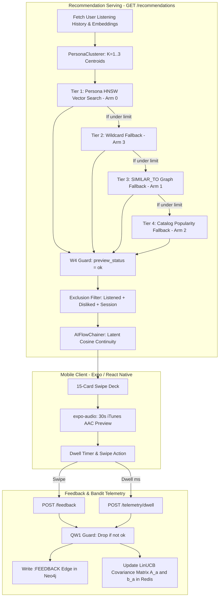

# SoundGraph Recommendation System: Architecture & Technical Specification (`docs/RECSYS.md`)

> **Document Status:** Live Reference (Synchronized with Codebase as of 2026-10-20)  
> **Source Files:** [`backend/graph/queries.py`](file:///run/media/sushitrash26/New%20Volume/GENAI/17thOct/soundgraph/backend/graph/queries.py), [`backend/core/bandit.py`](file:///run/media/sushitrash26/New%20Volume/GENAI/17thOct/soundgraph/backend/core/bandit.py), [`backend/embeddings/persona_clusterer.py`](file:///run/media/sushitrash26/New%20Volume/GENAI/17thOct/soundgraph/backend/embeddings/persona_clusterer.py), [`backend/audio/flow_chainer.py`](file:///run/media/sushitrash26/New%20Volume/GENAI/17thOct/soundgraph/backend/audio/flow_chainer.py), [`backend/services/preview_service.py`](file:///run/media/sushitrash26/New%20Volume/GENAI/17thOct/soundgraph/backend/services/preview_service.py).  
> **Legend:** `[IMPLEMENTED]` Verified live in production code · `[PARTIAL]` Heuristic or incomplete · `[PLANNED]` In playbook roadmap.

---

## 1. System Overview

SoundGraph operates a **hybrid graph-vector retrieval engine paired with contextual multi-armed bandit telemetry**.

The system combines:
1. **Dense Vector Retrieval `[IMPLEMENTED]`**: 768-dimensional Gemini text embeddings indexed in Neo4j via HNSW cosine vector index (`track_embeddings`).
2. **Multi-Centroid Taste Personas `[IMPLEMENTED]`**: Clusters user listening history into up to 3 distinct sub-personas using `KMeans`, weighted by play count and explicit ratings, with Rocchio negative repulsion.
3. **Graph Topology `[PARTIAL]`**: Connects tracks, artists, and genres in Neo4j. `SIMILAR_TO` edges exist across nodes but are currently unpruned and contain parallel edges (to be bounded in W7).
4. **Contextual LinUCB Multi-Armed Bandit `[PARTIAL]`**: Implements continuous reward calculations from dwell time and online Sherman-Morrison ridge regression updates in Redis. It is **not** currently in the serve path (arms are tagged statically by tier; active online policy scheduled for W9).
5. **Greedy Flow Chainer `[IMPLEMENTED]`**: Orders candidate cards via nearest-neighbor Hamiltonian cosine continuity in 768-D space. Audio key/pitch information is not used.
6. **Strict Audio Preview Playback `[IMPLEMENTED]`**: 30-second studio AAC/MP3 previews via Apple iTunes CDN (`audio-ssl.itunes.apple.com`) and Deezer fallback. W4 serve-time playability guard strictly guarantees 100% playable cards by construction.
7. **Learning Guard QW1 `[IMPLEMENTED]`**: Swipes or telemetry dwell events on unplayable or missing cards are safely dropped, preventing false penalties from corrupting user bandit profiles.



---

## 2. Data Substrate & Schema

### 2.1 Graph Schema (Neo4j AuraDB)
* **Node Types**:
  * `(:User {id, name, avatar_url})` `[IMPLEMENTED]` (6 nodes today)
  * `(:Track {id, name, source, preview_url, preview_source, preview_status, match_confidence, cover_url, energy, valence, danceability, tempo, popularity, embedding})` `[IMPLEMENTED]` (332 nodes today; 226 verified `preview_status = 'ok'`, 106 isolated `preview_status = 'failed'`)
  * `(:Artist {id, name, pagerank})` `[IMPLEMENTED]` (266 nodes today)
  * `(:Genre {name})` `[IMPLEMENTED]` (58 flat nodes)
  * `(:Mood)` `[PLANNED]` (0 nodes in DB today; mood is queried via acoustic thresholds or chat queries)
* **Relationship Types**:
  * `(:User)-[:LISTENED_TO {play_count, last_played, source}]->(:Track)` `[IMPLEMENTED]` (377 edges; timestamps reflect batch sync time)
  * `(:User)-[:FEEDBACK {reward: +1.0 | -1.0, updated_at}]->(:Track)` `[IMPLEMENTED]` (71 edges)
  * `(:Track)-[:BY]->(:Artist)` `[IMPLEMENTED]`
  * `(:Track)-[:IN_GENRE]->(:Genre)` `[IMPLEMENTED]`
  * `(:Track)-[:SIMILAR_TO {score}]->(:Track)` `[PARTIAL]` (8,333 track-to-track edges, with duplicate parallel edges to be cleaned in W7)

### 2.2 Vector Embeddings & Acoustic Features
* **Embedding Model `[IMPLEMENTED]`**: `models/gemini-embedding-2` producing 768-dimensional float vectors.
* **Input Text Structure `[IMPLEMENTED]`**:
  ```text
  Track: {title}. Artists: {artists}. Album: {album}. Genre elements: {genres}. Acoustic profile: energy {energy}, valence {valence}, danceability {danceability}, acousticness {acousticness}.
  ```
* **Acoustic Features `[PARTIAL]`**:
  * Spotify Tracks ($N=16$): Real Spotify audio features.
  * Non-Spotify Tracks ($N=316$): Features are synthesized from 768-D vectors via Semantic Differential Latent Axis Projection (`backend/embeddings/gemini_embedder.py:296`). Inferred features exhibit compression: 75.2% of energy values sit in $[0.40, 0.60]$, and 57.6% of valence values sit in $[0.40, 0.50]$.
  * Tempo: Known on only 8.4% of tracks; defaults to `120.0 BPM` elsewhere.

---

## 3. Retrieval & Candidate Generation

### 3.1 Taste Personas (`backend/embeddings/persona_clusterer.py`) `[IMPLEMENTED]`
* Instead of a single user centroid, users with listening history are clustered into $K$ personas via `KMeans`:
  $$K = \min\left(3, \max\left(1, \left\lfloor\frac{n}{2}\right\rfloor\right)\right)$$
* For $n \ge 6$ listened tracks, $K=3$.
* Persona centroids are computed as weighted averages based on play counts and feedback:
  $$w_i = \max(1.0, \text{plays}_i + 2.5 \cdot \text{reward}_i)$$
* Centroids undergo Rocchio negative repulsion from disliked tracks:
  $$\mu_k \leftarrow \mu_k - 0.30 \cdot \mu_{\text{disliked}}$$
* Centroids are renormalized to unit Euclidean length for cosine search.

### 3.2 Candidate Retrieval Waterfall (`backend/graph/queries.py:394`) `[IMPLEMENTED]`
Candidates are retrieved sequentially using an exclusion filter (`listened_ids`, `disliked_ids`, `session_ids`) and a strict playability guard (`coalesce(rec.preview_status, 'failed') = 'ok'`):
1. **Tier 1 (Persona Exploitation)**: Top 35 nearest vector neighbors queried per centroid via Neo4j HNSW index `db.index.vector.queryNodes('track_embeddings', 35, centroid)`. Round-robin interleaved up to requested limit. Tagged `bandit_arm = 0`.
2. **Tier 2 (Frontier Wildcard)**: Backfill queried only if Tier 1 underfills limit. Selects unlistened playable tracks ordered by popularity. Tagged `bandit_arm = 3`.
3. **Tier 3 (Graph Similarity)**: 1-2 hop neighbor traversal over `SIMILAR_TO` edges to playable tracks. Tagged `bandit_arm = 1`.
4. **Tier 4 (Catalog Diversity Fallback)**: General catalog playable tracks ordered by popularity. Tagged `bandit_arm = 2`.

---

## 4. Ordering & Flow

### 4.1 Candidate Ranking `[PARTIAL]`
* Candidates within Tier 1 carry vector similarity scores `(1.0 + vectorSimilarity) / 2.0`.
* Candidates across tiers are sorted by `(score, popularity DESC)`. A unified cross-tier ranker is `[PLANNED]` for W8.
* Artist frequency capping is currently `[PLANNED]` for W10 (up to 4 tracks by the same artist can currently appear in a single deck).

### 4.2 Latent Flow Chaining (`backend/audio/flow_chainer.py`) `[IMPLEMENTED]`
* Takes the candidate slice (up to 15 tracks) and constructs a continuous greedy Hamiltonian path based on cosine similarity in 768-D space:
  $$\text{Next Track} = \arg\max_{t \in \text{Remaining}} \cos(v_{\text{current}}, v_t)$$
* Anchor track is the highest-ranked candidate.
* Acoustic BPM/energy transition cost formulation is `[PLANNED]` for W10 after audio feature calibration.

---

## 5. Bandit & Feedback Telemetry

### 5.1 Contextual LinUCB (`backend/core/bandit.py`) `[PARTIAL]`
* **Context Vector $x \in \mathbb{R}^6$ `[IMPLEMENTED]`**:
  $$x = \left[\sin\left(\frac{2\pi h}{24}\right), \cos\left(\frac{2\pi h}{24}\right), \min\left(\frac{\text{depth}}{20}, 1\right), 2(v - 0.5), 2(e - 0.5), 2(\text{ent} - 0.5)\right]$$
  *(Note: Hour $h$ uses server time; user-local timezone is `[PLANNED]` for QW5).*
* **Continuous Reward Formulation `[IMPLEMENTED]`**:
  $$r_{\text{dwell}} = \tanh\left(\frac{\text{dwell\_ms} - 5000}{7000}\right) \in [-1.0, 1.0]$$
  Explicit swipe (+1.0 / −1.0) blends with dwell: $r = 0.6 \cdot r_{\text{explicit}} + 0.4 \cdot r_{\text{dwell}}$.
* **Online Ridge Regression `[IMPLEMENTED]`**:
  Updates covariance matrix $A_a \leftarrow A_a + x x^T$ and vector $b_a \leftarrow b_a + r x$ in Redis (`bandit:{user_id}:arm_{arm}`) with 90-day TTL.
* **Serve-Time Selection `[PLANNED]`**:
  Currently, `select_arm()` is not in the serve path. Active LinUCB / Thompson Sampling slot allocation is scheduled for W9.

---

## 6. Client Interface & Audio Playback

### 6.1 Swipe Card Deck `[IMPLEMENTED]`
* Tinder-style swipe cards rendered via React Native / Expo (`mobile/src/screens/CuratedDeckScreen.js`).
* Right swipe triggers `POST /feedback {reward: 1.0}`; Left swipe triggers `POST /feedback {reward: -1.0}`.

### 6.2 Strict Audio Preview Playback `[IMPLEMENTED]`
* **iTunes & Deezer Streams**: Streamed in-app via `expo-audio` as 30-second studio AAC/MP3 clips.
* **Playability Enforcement**: `PreviewVerifier` strictly checks HTTP 200/206, `audio/*` content type, and allowlisted hosts.
* **100% Playable Deck Guarantee**: Recommendation queries require `coalesce(rec.preview_status, 'failed') = 'ok'`. Silent cards or web links can never be served.

---

## 7. Impression & Event Logging (Workstream W1) `[IMPLEMENTED]`

### 7.1 Relational Event Architecture
* SQLite WAL-mode datastore (`backend/data/soundgraph_events.db`) and PostgreSQL DDL (`backend/data/migrations/001_create_events_tables.sql`).
* **Requests Table**: Logs `request_id`, user, endpoint, parameters, tier candidate counts (`candidate_counts`), served track sequence (`candidate_snapshot`), provenance versions, and latency.
* **Impressions Table**: Logs every served recommendation card with `impression_id`, `request_id`, track, 0-based deck `position`, arm index, rank in source, scores, propensity, context vector, and playability status.
* **Events Table**: Idempotent batch event ingestion (`POST /events`) for client telemetry (`impression`, `dwell_threshold`, `completion`, `like`, `dislike`, `skip`, `share`, `save`) deduplicated on `event_id`.

### 7.2 Deck Replay & GDPR Compliance
* **Deterministic Deck Replay (`GET /recommendations/deck/{request_id}`)**: Reconstructs the exact card deck, scores, and context vectors served to any user.
* **GDPR Cascading Purge (`DELETE /user/{user_id}/data`)**: Foreign-key cascade permanently erases user requests, impressions, and events upon request.

---

## 8. Offline Evaluation Harness (Workstream W2) `[IMPLEMENTED]`

### 8.1 Benchmark Runner (`eval/run.py`)
* Command-line runner: `python -m eval.run --config config/recsys.yaml`.
* Splits user histories into 80% train and 20% test folds chronologically (with seeded fallback for batch-synced imports).
* Computes Recall@K, HitRate@K, NDCG@K, MRR, Coverage@K, Novelty@K (Laplace-smoothed), Intra-List Distance (ILD), and Artist Repeat Rate.
* Evaluates pairwise AUC against 71 explicit `:FEEDBACK` labels (liked vs disliked).
* Generates 1,000-sample bootstrap 95% Confidence Intervals.
* Outputs machine-readable JSON metrics (`docs/benchmarks/w2_baseline_metrics.json`) and Markdown executive summaries (`docs/benchmarks/baseline_report.md`).

---

## 9. Catalog Expansion & Quality Gates (Workstream W3) `[IMPLEMENTED]`

### 9.1 Multi-Provider Frontier Harvesting
* **Seeds**: Queries existing library artists from Neo4j (266 base artists).
* **Ingestion Pipeline (`backend/services/catalog_expansion.py`)**:
  - Rate-limited provider queries via `TokenBucketRateLimiter` (iTunes Search API & Deezer).
  - Per-artist cap: top 5 by rank/popularity + 2 deep cuts.
  - Quality gates: duration 60s–600s, non-empty artwork, strict regex blocklist (rejects karaoke, tribute, 8D, slowed, sped up, nightcore, "type beat").
  - Preview verification: every candidate preview URL verified with HTTP 206 ranged GET and `audio/*` content type via `PreviewVerifier`.
* **Dense Vector & Semantic Feature Derivation**:
  - 768-D Gemini text embeddings generated in batches.
  - Semantic differential latent axis projection derives continuous acoustic features (`energy`, `valence`, `danceability`, `acousticness`).
  - High-dimensional canonical anchor projection infers multi-genre affiliations.
* **Graph Ingestion & Capacity Safety**:
  - Merges tracks into Neo4j without dense pairwise `SIMILAR_TO` edges to avoid relationship explosion and stay under 80% AuraDB limits.
  - Checkpointed state saved to `backend/data/catalog_expansion_checkpoint.json` for pause/resume idempotency.

---

## 10. Acoustic Feature Calibration & Source Tagging (Workstream W5 Part A) `[IMPLEMENTED]`

### 10.1 Multi-Anchor Ensemble Differential
* Replaces single-axis poles with **5 curated bipolar anchor pairs per acoustic axis** (`energy`, `valence`, `danceability`, `acousticness`).
* For a 768-D track vector $e$:
  $$s_j = \cos(e, \text{pos}_j) - \cos(e, \text{neg}_j)$$
  $$\text{raw} = \frac{1}{M}\sum_{j=1}^M s_j$$
* Raw differential scores stored explicitly on track nodes (`energy_raw`, `valence_raw`, etc.).

### 10.2 Empirical Percentile Ranking
* Spreads raw scores uniformly across the catalog into empirical percentiles in $[0.01, 0.99]$:
  $$\text{percentile} = \text{clip}\left(\frac{\text{rank}(\text{raw}) - 0.5}{N}, 0.01, 0.99\right)$$
* Completely resolves the compressed-band problem (F-06 / F-32) where mood filters were selecting severely skewed catalog shares.

### 10.3 Ground Truth Validation & Confidence Intervals
* Rigorously validated against the $N=28$ verified Spotify ground-truth tracks:
  - **Energy**: Spearman $\rho = +0.758$ ($p = 0.0000$), 95% CI: $[+0.550, +0.891]$
  - **Valence**: Spearman $\rho = +0.526$ ($p = 0.0040$), 95% CI: $[+0.065, +0.855]$
  - **Danceability**: Spearman $\rho = +0.664$ ($p = 0.0001$), 95% CI: $[+0.405, +0.836]$
  - **Acousticness**: Spearman $\rho = +0.605$ ($p = 0.0011$), 95% CI: $[+0.227, +0.864]$

### 10.4 Feature Source & Confidence Tagging
* Every track tagged with:
  - `feature_source`: `'spotify'` for ground-truth tracks ($N=28$); `'text_proxy'` for semantic differential tracks.
  - `feature_confidence`: $1.0$ for ground truth; $0.65$ for text proxy.
* Non-circularity enforced: Embedding text v2 format (`"{title} by {artists}. Album: {album}. Genres: {genres}"`) removes numeric feature strings from the text to be embedded (F-21).

---

## 11. Graph Topology Pruning & Reciprocal Rank Fusion (Workstream W7) `[IMPLEMENTED]`

### 11.1 Graph Topology Pruning & Degree Bounding
* **Non-Track Relationship Deletion**: Pruned all 35,099 spurious `SIMILAR_TO` edges connecting non-Track nodes (Track<->Artist, Track<->Genre, Artist<->Artist, Genre<->Genre).
* **Parallel Duplicate Edge Deduplication**: Deduplicated 531 parallel track pairs down to single maximum-score edges.
* **Mutual Top-10 Degree Bounding**: Maximum degree capped at 10 edges per track (average degree 8.61), with surviving edges tagged `source = 'hnsw_pruned'`. Total `SIMILAR_TO` edges reduced by 95.1% (from 43,432 down to 2,117).

### 11.2 Reciprocal Rank Fusion (RRF) Candidate Combiner
* Replaced ad-hoc waterfall fallbacks and mixed score scales (cosine vs graph edge vs hardcoded popularity) with rank-based Reciprocal Rank Fusion:
  $$RRF(d) = \sum_{s \in \text{Sources}} \frac{w_s}{60 + \text{rank}_s(d)}$$
* Default source weights:
  - `persona_text`: **1.0** (HNSW vector retrieval across taste persona centroids and medoids with adaptive over-fetch $k_{\text{fetch}} \ge 200$)
  - `similar_to`: **0.6** (Bounded graph similarity from user's listened tracks)
  - `catalog`: **0.3** (Global catalog diversity and popularity)
* Provides rank-based stability, overlap boosts for multi-channel candidates, and auditable impression ledger logging.

---

## 12. User Modeling & Session Dynamics (Workstream W6) `[IMPLEMENTED]`

### 12.1 Interaction Weighting
* Sub-linear weighting saturating at 50 plays with explicit feedback multipliers:
  $$w_i = \min\left(1.0, \frac{\log(1 + \text{plays}_i)}{\log(1 + 50)}\right) \cdot h_i$$
  where $h_i = 1.5$ for explicit likes, $0.5$ for explicit dislikes, and $1.0$ for neutral plays.

### 12.2 Medoid Grounding & Persona Mass
* Top-3 closest member tracks stored alongside each centroid $\mu_k$ as physical medoids:
  $$\text{medoids}_k = \text{argtop3}_{j \in C_k} (\cos(v_j, \mu_k))$$
* Persona mass $m_k = \sum_{i \in C_k} w_i / \sum_j w_j$ allocated dynamically.
* Context conditioning $a_k(b) = (c_{k,b} + \alpha \cdot m_k) / (\sum c_{k',b} + \alpha)$ with $\alpha = 5$ across 4 user-local time buckets.

### 12.3 Transient Session Adaptation & Negative Memory
* Online session drift vector $s$: updated dynamically on swipe actions ($s \leftarrow \text{norm}((1-\eta)s + \eta v)$ on like with $\eta = 0.30$, and $s \leftarrow \text{norm}(s - \eta' v)$ on dislike with $\eta' = 0.15$).
* Negative memory ledger $D$ retains up to 50 most recent disliked vectors in UnifiedCache, applying calibrated repulsion penalty:
  $$\text{pen}(v) = \text{clip}\left(\frac{\max_{d \in D} \cos(v, d) - 0.75}{0.25}, 0.0, 1.0\right)$$

---

## 13. Pointwise Multi-Signal Ranker & Deck Sequencing (Workstream W8 & W10) `[IMPLEMENTED]`

### 13.1 Pointwise Multi-Signal Ranker
* Evaluates all candidates across 8 calibrated signals before card selection:
  $$\text{score}(d) = 1.00 \cdot \text{sim\_persona}(d) + 0.80 \cdot \text{sim\_session}(d) + 0.30 \cdot \text{pop\_pct}(d) + 0.25 \cdot \text{novelty}(d) + 0.20 \cdot (\text{mood\_match}(d) \cdot \text{conf}(d)) + 0.10 \cdot \text{source\_prior}(d) - 0.80 \cdot \text{pen}(d) - 0.50 \cdot (1 - \text{preview\_conf}(d))$$
* **Calibrated Soft Mood Match**: Replaced binary SQL/Cypher step cutoffs with continuous Euclidean proximity to mood coordinates, weighted by `feature_confidence`.

### 13.2 Diversity Re-ranking via MMR & Hard Caps
* Greedy Maximal Marginal Relevance ($\lambda = 0.70$):
  $$\text{next} = \text{argmax}_{d \in C \setminus S} \left[ \lambda \cdot \text{score}(d) - (1 - \lambda) \cdot \max_{s \in S} \text{sim}(d, s) \right]$$
  with artist repetition penalty $\text{sim}(d, s) = \cos(v_d, v_s) + 0.50$ if same artist.
* **Hard Constraints**: Maximum 2 tracks per artist per deck, maximum 8 tracks ($\le 50\%$) from any single persona cluster.

### 13.3 Deck Arc Sequencing
* Arranges the 15-card deck into an optimal listening arc:
  - Positions 1 & 2: High-confidence exploit hooks.
  - Positions 5, 9, 13: Spaced discovery/explore cards.
  - Position 15: Strong exploit closer.
  - Audio transitions: Smoothed by `AIFlowChainer` for harmonic key and tempo transitions.
